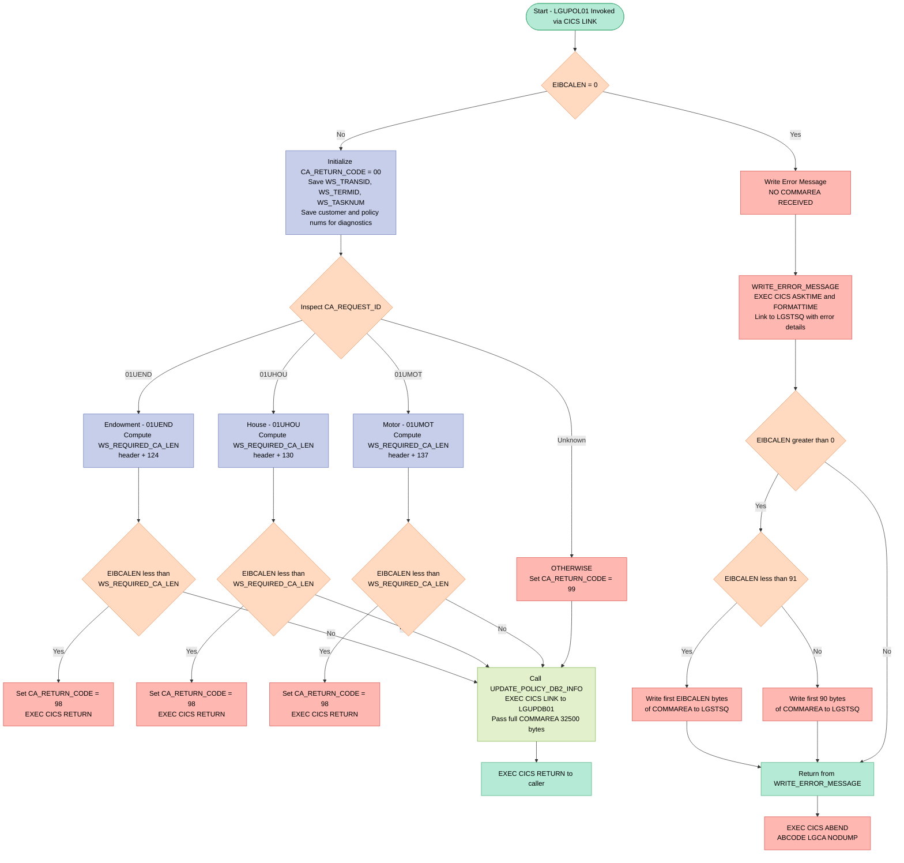
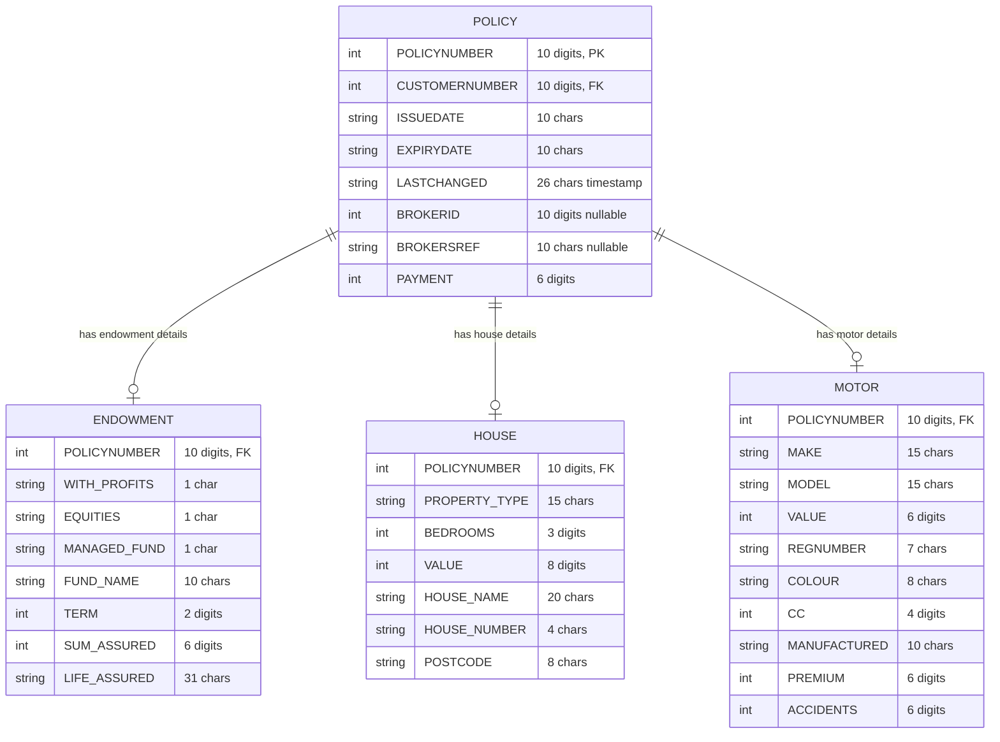

## Table of Contents

- [1. Purpose](#1-purpose)
- [2. Inputs](#2-inputs)
  - [2.1 CICS Communication Area (COMMAREA)](#21-cics-communication-area-commarea)
  - [2.2 CICS Execution Interface Block (EIB)](#22-cics-execution-interface-block-eib)
  - [2.3 Linked Program Responses](#23-linked-program-responses)
- [3. Outputs](#3-outputs)
- [4. Processing Logic](#4-processing-logic)
  - [4.1 Mermaid Flow Diagram](#41-mermaid-flow-diagram)
  - [4.2 Processing Logic Description](#42-processing-logic-description)
  - [4.3 Database Tables](#43-database-tables)
- [5. Paragraphs](#5-paragraphs)
- [6. Dependencies](#6-dependencies)
  - [6.1 CICS Runtime Dependencies](#61-cics-runtime-dependencies)
  - [6.2 Invoked External Programs (CICS LINK)](#62-invoked-external-programs-cics-link)
  - [6.3 COMMAREA / Input Interface](#63-commarea--input-interface)
  - [6.4 Include / Copybook Dependencies](#64-include--copybook-dependencies)
  - [6.5 Caller (Upstream Dependency)](#65-caller-upstream-dependency)
  - [6.6 Policy Type Routing (Request Codes)](#66-policy-type-routing-request-codes)
- [7. Constraints](#7-constraints)
  - [7.1 Communication Area (COMMAREA) Presence](#71-communication-area-commarea-presence)
  - [7.2 Communication Area Minimum Length](#72-communication-area-minimum-length)
  - [7.3 Request Identifier Validity](#73-request-identifier-validity)
  - [7.4 COMMAREA Field Format Constraints](#74-commarea-field-format-constraints)
  - [7.5 Endowment-Specific Field Constraints](#75-endowment-specific-field-constraints)
  - [7.6 House-Specific Field Constraints](#76-house-specific-field-constraints)
  - [7.7 Motor-Specific Field Constraints](#77-motor-specific-field-constraints)
  - [7.8 Processing Sequence Constraints](#78-processing-sequence-constraints)
  - [7.9 Resource and Buffer Limits](#79-resource-and-buffer-limits)
- [8. Error Handling](#8-error-handling)
  - [8.1 Missing Communication Area (COMMAREA) Guard](#81-missing-communication-area-commarea-guard)
  - [8.2 Communication Area Length Validation](#82-communication-area-length-validation)
  - [8.3 Unrecognized Request Identifier Handling](#83-unrecognized-request-identifier-handling)
  - [8.4 Return Code Communication to Caller](#84-return-code-communication-to-caller)
  - [8.5 Diagnostic Logging via Error Message Procedure](#85-diagnostic-logging-via-error-message-procedure)
  - [8.6 Pre-population of Diagnostic Fields](#86-pre-population-of-diagnostic-fields)
- [9. Examples](#9-examples)
  - [9.1 Example 1: Successful Motor Policy Update](#91-example-1-successful-motor-policy-update)
  - [9.2 Example 2: Endowment Policy Update — COMMAREA Too Short](#92-example-2-endowment-policy-update--commarea-too-short)
  - [9.3 Example 3: Unrecognized Request ID](#93-example-3-unrecognized-request-id)

## 1. Purpose

`LGUPOL01` is a CICS-hosted PL/I program that serves as the business-logic front-end for updating existing insurance policies in the GenApp system. It receives a communication area identifying the policy type to be updated (endowment, house, or motor), validates that the communication area is sufficiently large for the requested policy type, and then delegates the actual database update to the back-end program `LGUPDB01` via a CICS LINK call. If no communication area is present the program abends, if the communication area is too short it returns error code `98`, and if an unrecognised request type is supplied it returns error code `99`; successful requests pass all policy data — customer number, policy number, dates, broker details, and policy-specific fields — transparently through to `LGUPDB01` for persistence.

## 2. Inputs

### 2.1 CICS Communication Area (COMMAREA)

The program receives its entire input through a single CICS COMMAREA, passed in as the procedure parameter `COMM_AREA_PTR`. All fields below are overlaid on this area via the `COMM_AREA` based structure.

**COMMAREA Header Fields**

- `CA_REQUEST_ID` *(CHAR(6))* — Identifies the type of policy update operation to perform. Drives the main SELECT routing logic; recognised values are `'01UEND'` (endowment), `'01UHOU'` (house), and `'01UMOT'` (motor). Any other value causes `CA_RETURN_CODE` to be set to `'99'`.
- `CA_RETURN_CODE` *(PIC '99')* — Output field written back to the caller to signal the outcome: `'00'` = success, `'98'` = COMMAREA too short for the requested policy type, `'99'` = unrecognised request ID.
- `CA_CUSTOMER_NUM` *(PIC '9999999999')* — Unique customer identifier. Captured into the error-message structure (`EM_CUSNUM`) for diagnostic tracing on failure.

**Policy Request Fields (`CA_POLICY_REQUEST`)**

- `CA_POLICY_NUM` *(PIC '9999999999')* — Unique policy identifier for the policy being updated. Saved into `EM_POLNUM` for diagnostic tracing on failure.
- `CA_POLICY_COMMON` — Composite structure holding the shared attributes submitted for the DB2 update:
  - `CA_ISSUE_DATE` *(CHAR(10))* — Original issue date of the policy.
  - `CA_EXPIRY_DATE` *(CHAR(10))* — Expiry date of the policy.
  - `CA_LASTCHANGED` *(CHAR(26))* — Timestamp of the last change to the policy record.
  - `CA_BROKERID` *(PIC '9999999999')* — Broker identifier; nullable DB2 column, handled via `IND_BROKERID`.
  - `CA_BROKERSREF` *(CHAR(10))* — Broker's own reference code; nullable DB2 column, handled via `IND_BROKERSREF`.
  - `CA_PAYMENT` *(PIC '999999')* — Premium payment amount; nullable DB2 column, handled via `IND_PAYMENT`.
  - `CA_POLICY_SPECIFIC` — Union of policy-type-specific detail fields:
    - **Endowment** (`CA_ENDOWMENT`): `CA_E_WITH_PROFITS`, `CA_E_EQUITIES`, `CA_E_MANAGED_FUND`, `CA_E_FUND_NAME`, `CA_E_TERM`, `CA_E_SUM_ASSURED`, `CA_E_LIFE_ASSURED`
    - **House** (`CA_HOUSE`): `CA_H_PROPERTY_TYPE`, `CA_H_BEDROOMS`, `CA_H_VALUE`, `CA_H_HOUSE_NAME`, `CA_H_HOUSE_NUMBER`, `CA_H_POSTCODE`
    - **Motor** (`CA_MOTOR`): `CA_M_MAKE`, `CA_M_MODEL`, `CA_M_VALUE`, `CA_M_REGNUMBER`, `CA_M_COLOUR`, `CA_M_CC`, `CA_M_MANUFACTURED`, `CA_M_PREMIUM`, `CA_M_ACCIDENTS`

### 2.2 CICS Execution Interface Block (EIB)

These fields are provided automatically by the CICS runtime and are read directly by the program:

- `EIBCALEN` — Length of the received COMMAREA. Validated at entry (abend `LGCA` if zero); compared against the computed minimum required length for each policy type to gate the update.
- `EIBTRNID` — Transaction identifier of the current CICS task; saved into `WS_TRANSID` for diagnostic purposes.
- `EIBTRMID` — Terminal identifier of the current CICS task; saved into `WS_TERMID` for diagnostic purposes.
- `EIBTASKN` — Task number of the current CICS task; saved into `WS_TASKNUM` for diagnostic purposes.

### 2.3 Linked Program Responses

- `LGUPDB01` (DB2 back-end update program) — Called via `EXEC CICS LINK` with `COMM_AREA_RAW` as the COMMAREA. The back-end program performs the actual DB2 update and may modify fields within the COMMAREA (e.g., `CA_RETURN_CODE`) that are visible to the caller after `LGUPOL01` returns.

## 3. Outputs

**Communication Area (`COMM_AREA`) — Returned to Caller**

- `CA_RETURN_CODE`
  - The primary outcome indicator written back to the calling program via the communication area
  - Set to `'00'` on successful initialisation (normal path proceeds to DB2 update)
  - Set to `'98'` if the incoming communication area is too short for the requested policy type (`01UEND`, `01UHOU`, or `01UMOT`); program returns immediately to the caller with this code
  - Set to `'99'` if `CA_REQUEST_ID` does not match any recognised policy type

- `COMM_AREA_RAW` (full communication area, updated by LGUPDB01)
  - Passed as the `COMMAREA` to the back-end database update program `LGUPDB01` via `EXEC CICS LINK`
  - After the link completes, the communication area (including any fields updated by `LGUPDB01`, such as `CA_RETURN_CODE` and policy-specific data) is returned in-place to the caller of `LGUPOL01`
  - The fields carried into `LGUPDB01` and thus indirectly part of the output back-channel include:
    - `CA_POLICY_NUM` — identifies which policy record was targeted for update
    - `CA_CUSTOMER_NUM` — identifies the customer whose policy was updated
    - `CA_POLICY_COMMON` — the common policy attributes submitted for update (issue date, expiry date, broker ID, broker reference, payment); any acknowledgement or modification by `LGUPDB01` is reflected here
      - `CA_ISSUE_DATE` — policy issue date sent for update
      - `CA_EXPIRY_DATE` — policy expiry date sent for update
      - `CA_PAYMENT` — premium payment amount sent for update
      - `CA_BROKERID` — broker identifier sent for update (nullable, guarded by `IND_BROKERID`)
      - `CA_BROKERSREF` — broker reference sent for update (nullable, guarded by `IND_BROKERSREF`)

**CICS Abend — Abnormal Termination**

- `EXEC CICS ABEND ABCODE('LGCA') NODUMP`
  - Issued when no communication area is received (`EIBCALEN = 0`)
  - Terminates the CICS task with abend code `LGCA`; `NODUMP` suppresses a system dump
  - The abnormal termination itself is an observable side effect visible in CICS logs and the calling environment

**Transient Data Queue (TDQ) Writes — Diagnostic / Error Logging**

All TDQ writes are routed through program `LGSTSQ` via `EXEC CICS LINK`. They occur only when the `WRITE_ERROR_MESSAGE` procedure is invoked (triggered when no commarea is present).

- `ERROR_MSG` — written to TDQ as the primary error log record
  - Contains a timestamped, formatted message including:
    - `EM_DATE` — current date formatted as `MMDDYYYY`
    - `EM_TIME` — current time
    - Program name (`LGUPOL01`, embedded as a literal)
    - `EM_CUSNUM` — customer number copied from `CA_CUSTOMER_NUM`
    - `EM_POLNUM` — policy number copied from `CA_POLICY_NUM`
    - `EM_MSG_TEXT` — descriptive error text (e.g., `' NO COMMAREA RECEIVED'`)

- `CA_ERROR_MSG` — written to TDQ as a secondary diagnostic record containing raw communication area data
  - `CA_DATA` holds up to 90 bytes of `COMM_AREA_RAW`; if `EIBCALEN` is between 1 and 90, only the actual available bytes are captured; otherwise a full 90-byte extract is written
  - Provides a raw dump of the commarea at the point of failure for diagnostic tracing

## 4. Processing Logic

### 4.1 Mermaid Flow Diagram



---

### 4.2 Processing Logic Description

#### 4.2.1 High-level Summary

`LGUPOL01` is a CICS **policy update orchestrator** program for the General Insurance Application. It receives a COMMAREA from a calling menu program (e.g., `LGTESTP1`–`LGTESTP4`), validates the request type and COMMAREA length, then delegates the actual DB2 update to the back-end program `LGUPDB01` via `EXEC CICS LINK`. It handles three insurance policy types: **Endowment**, **House**, and **Motor**.

---

#### 4.2.2 Execution Flow

**Step 1 — Program Entry and EIB Initialization**
The program is declared as `Proc(COMM_AREA_PTR) Options(Main)`, receiving the COMMAREA pointer passed by the CICS runtime. Immediately, EIB fields are captured into working storage: `EIBTRNID` → `WS_TRANSID`, `EIBTRMID` → `WS_TERMID`, `EIBTASKN` → `WS_TASKNUM`. These are stored in the `WS_HEADER` eyecatcher area (`LGUPOL01------WS`) to aid in dump diagnostics.

**Step 2 — COMMAREA Presence Check**
If `EIBCALEN = 0`, no COMMAREA was passed. The program writes the message `NO COMMAREA RECEIVED` to the error log via `WRITE_ERROR_MESSAGE`, then issues `EXEC CICS ABEND ABCODE('LGCA') NODUMP` to terminate abnormally without producing a transaction dump.

**Step 3 — COMMAREA Initialization**
- `CA_RETURN_CODE` is set to `'00'` (success by default).
- `EIBCALEN` is saved into `WS_CALEN`.
- The COMMAREA pointer is saved in `WS_ADDR_DFHCOMMAREA`.
- Customer number (`CA_CUSTOMER_NUM`) and policy number (`CA_POLICY_NUM`) are copied into the `ERROR_MSG` structure so they are available if a diagnostic log entry is needed later.

**Step 4 — Policy Type Routing via SELECT**
The program uses a PL/I `SELECT` statement on `CA_REQUEST_ID` to branch to the appropriate policy validation:

| `CA_REQUEST_ID` | Policy Type | Min COMMAREA Length |
|---|---|---|
| `'01UEND'` | Endowment | 28 (header) + 124 = **152** |
| `'01UHOU'` | House | 28 (header) + 130 = **158** |
| `'01UMOT'` | Motor | 28 (header) + 137 = **165** |
| Any other | Unknown | N/A |

For each recognized type, `WS_REQUIRED_CA_LEN` is computed by summing `WS_CA_HEADER_LEN` (28) and the appropriate full-length constant. If `EIBCALEN` is less than this minimum, `CA_RETURN_CODE` is set to `'98'` and `EXEC CICS RETURN` exits immediately back to the caller — no update is attempted.

For an unrecognized `CA_REQUEST_ID`, the `OTHERWISE` branch sets `CA_RETURN_CODE = '99'` but **does not return early** — execution falls through to the DB2 link call. This allows the back-end program to also perform its own validation.

**Step 5 — DB2 Update Delegation (`UPDATE_POLICY_DB2_INFO`)**
After validation, the internal procedure `UPDATE_POLICY_DB2_INFO` is called unconditionally. It issues:
```
EXEC CICS LINK Program('LGUPDB01') Commarea(COMM_AREA_RAW) LENGTH(32500)
```
The entire raw COMMAREA (up to 32,500 bytes) is passed to `LGUPDB01`, which performs the actual DB2 `UPDATE` statement for the appropriate policy type. Control returns to `LGUPOL01` once `LGUPDB01` finishes.

**Step 6 — Return to Caller**
`EXEC CICS RETURN` passes control back to the original calling program (e.g., a menu transaction). The outcome is communicated solely through `CA_RETURN_CODE` in the shared COMMAREA.

---

#### 4.2.3 `WRITE_ERROR_MESSAGE` Procedure

This internal procedure is invoked only when no COMMAREA is received:
1. `EXEC CICS ASKTIME` retrieves the current absolute time into `WS_ABSTIME`.
2. `EXEC CICS FORMATTIME` converts it to a human-readable date (`MM/DD/YYYY`) and time (`HH:MM:SS`).
3. The formatted `ERROR_MSG` (containing date, time, program name `LGUPOL01`, customer/policy numbers) is written to a Transient Data Queue via `EXEC CICS LINK PROGRAM('LGSTSQ')`.
4. A second log entry writes up to 90 bytes of the raw COMMAREA for diagnostics:
   - If `EIBCALEN < 91`, the exact COMMAREA contents are logged.
   - Otherwise, the first 90 bytes are logged.

---

#### 4.2.4 External Interactions

| System / Program | Interaction Type | Purpose |
|---|---|---|
| `LGUPDB01` | `EXEC CICS LINK` | Back-end DB2 program that performs the actual SQL UPDATE for the policy record |
| `LGSTSQ` | `EXEC CICS LINK` | Transient Data Queue writer; logs error/diagnostic messages to a CICS TS queue |
| CICS EIB | Built-in fields | `EIBCALEN`, `EIBTRNID`, `EIBTRMID`, `EIBTASKN` used for validation and diagnostics |

---

#### 4.2.5 Plain Language Summary

`LGUPOL01` acts as a **gatekeeper and router** for insurance policy update requests. When invoked, it first ensures a valid request packet (COMMAREA) was provided — if not, it immediately logs an error and abends. It then reads the request type code to determine which kind of policy (Endowment, House, or Motor) is being updated, and checks that the request packet is large enough to contain all the required data fields. If the packet is too small, it returns an error code `98` to the caller without doing any work. For valid requests, it hands off the full request packet to the specialist DB2 program `LGUPDB01`, which performs the actual database update. The result (`'00'` for success or an error code) is communicated back to the caller through the same request packet.

---

### 4.3 Database Tables

`LGUPOL01` itself contains no direct SQL statements. All DB2 interactions are delegated to `LGUPDB01`. Based on the COMMAREA structures passed, the following tables are updated downstream:



## 5. Paragraphs

**Main Procedure Body (LGUPOL01 inline logic)**

- This is the top-level executable body of the `LGUPOL01` procedure, which runs when the program is invoked by CICS as a linked program.
- Initialises working-storage diagnostic fields by copying the CICS EIB values: `WS_TRANSID` ← `EIBTRNID`, `WS_TERMID` ← `EIBTRMID`, `WS_TASKNUM` ← `EIBTASKN`.
- **COMMAREA presence check:** tests whether `EIBCALEN = 0`. If no COMMAREA was received:
  - Sets `EM_MSG_TEXT` to `' NO COMMAREA RECEIVED'`.
  - Calls `WRITE_ERROR_MESSAGE` to log the error to a CICS Transient Data Queue (TDQ).
  - Issues `EXEC CICS ABEND ABCODE('LGCA') NODUMP` to terminate the task with abend code `LGCA` without producing a dump.
- Initialises `CA_RETURN_CODE` to `'00'` (success), saves `EIBCALEN` into `WS_CALEN`, and records the COMMAREA pointer in `WS_ADDR_DFHCOMMAREA` for diagnostic purposes.
- Copies `CA_CUSTOMER_NUM` and `CA_POLICY_NUM` into `EM_CUSNUM` / `EM_POLNUM` so they are available in any subsequent error messages.
- **Policy-type routing via SELECT block:** evaluates `CA_REQUEST_ID` to determine the type of update requested:
  - `'01UEND'` (endowment): computes the required minimum COMMAREA length as `WS_CA_HEADER_LEN + WS_FULL_ENDOW_LEN` (28 + 124 = 152). If `EIBCALEN` is less than this, sets `CA_RETURN_CODE = '98'` and issues `EXEC CICS RETURN` immediately.
  - `'01UHOU'` (house): same pattern using `WS_FULL_HOUSE_LEN` (130), minimum = 158.
  - `'01UMOT'` (motor): same pattern using `WS_FULL_MOTOR_LEN` (137), minimum = 165.
  - `OTHERWISE`: sets `CA_RETURN_CODE = '99'` to signal an unrecognised request type; does not return immediately.
- After the SELECT block, calls internal procedure `UPDATE_POLICY_DB2_INFO` to forward the update to the back-end DB2 program.
- Issues `EXEC CICS RETURN` to return control to the calling program.

---

**UPDATE_POLICY_DB2_INFO**

- An internal procedure responsible for delegating the actual policy update to the back-end database program `LGUPDB01`.
- Issues `EXEC CICS LINK PROGRAM('LGUPDB01') COMMAREA(COMM_AREA_RAW) LENGTH(32500)`, passing the entire raw COMMAREA (up to 32,500 bytes) to `LGUPDB01`.
- `LGUPDB01` performs the DB2 UPDATE operations for the appropriate policy type and places the result back in the COMMAREA (reflected through `CA_RETURN_CODE`).
- Contains no conditional logic, loops, or additional error handling; it is a straight-through delegation wrapper.

---

**WRITE_ERROR_MESSAGE**

- An internal procedure that formats and writes diagnostic error information to a CICS Transient Data Queue (TDQ) via the shared utility program `LGSTSQ`.
- **Timestamp acquisition:** calls `EXEC CICS ASKTIME ABSTIME(WS_ABSTIME)` to obtain the current absolute time, then `EXEC CICS FORMATTIME` with `MMDDYYYY` and `TIME` options to convert it into human-readable date (`WS_DATE`) and time (`WS_TIME`) strings, which are then placed into the `ERROR_MSG` structure fields `EM_DATE` and `EM_TIME`.
- **Primary error message write:** issues `EXEC CICS LINK PROGRAM('LGSTSQ') COMMAREA(ERROR_MSG)` to write the formatted error message (including date, time, program name `LGUPOL01`, customer number, policy number, SQL request description, and SQLCODE) to the TDQ.
- **COMMAREA snapshot write:** conditionally captures the first portion of the raw COMMAREA into `CA_DATA` for additional context:
  - If `EIBCALEN > 0` and `EIBCALEN < 91`: copies exactly `EIBCALEN` bytes from `COMM_AREA_RAW` using the `LEFT` built-in function into `CA_DATA`, then links to `LGSTSQ` with `CA_ERROR_MSG`.
  - If `EIBCALEN >= 91`: copies the first 90 bytes from `COMM_AREA_RAW` into `CA_DATA`, then links to `LGSTSQ` with `CA_ERROR_MSG`.
  - If `EIBCALEN = 0`: skips the COMMAREA snapshot entirely.
- No loops are used; branching is via nested `IF/THEN/ELSE` blocks on `EIBCALEN`.

## 6. Dependencies

### 6.1 CICS Runtime Dependencies

- **CICS Runtime Environment**
  - The program runs as a CICS transaction; all control flow, communication, and error handling depend on the CICS runtime being active
  - **EIBCALEN** — CICS Execute Interface Block field providing the length of the incoming COMMAREA; used at entry to validate that a COMMAREA was received and that it is long enough for the requested policy type
  - **EIBTRNID** — EIB field supplying the 4-character CICS transaction identifier; stored in `WS_TRANSID` for diagnostic identification
  - **EIBTRMID** — EIB field supplying the 4-character terminal identifier; stored in `WS_TERMID` for diagnostic identification
  - **EIBTASKN** — EIB field supplying the CICS task number; stored in `WS_TASKNUM` for diagnostic identification
  - **`EXEC CICS RETURN`** — terminates the current CICS task and returns control to the caller; issued on both normal completion and validation failure (return code `98`)
  - **`EXEC CICS ABEND ABCODE('LGCA') NODUMP`** — issues a CICS abend with user abend code `LGCA` (without producing a dump) when no COMMAREA is received at all
  - **`EXEC CICS ASKTIME` / `EXEC CICS FORMATTIME`** — CICS time services used in `WRITE_ERROR_MESSAGE` to obtain the current absolute time and format it as a date (`WS_DATE`) and time (`WS_TIME`) for inclusion in error log entries

### 6.2 Invoked External Programs (CICS LINK)

- **`LGUPDB01`** — the DB2 back-end policy update program
  - Invoked via `EXEC CICS LINK PROGRAM('LGUPDB01') COMMAREA(COMM_AREA_RAW) LENGTH(32500)` inside the `UPDATE_POLICY_DB2_INFO` internal procedure
  - Receives the full 32 500-byte raw COMMAREA and performs the actual DB2 update for the policy; results are returned via the same COMMAREA (return code in `CA_RETURN_CODE`)
  - The program name is also held in the working-storage field `LGUPDB1 CHAR(8) INIT('LGUPDB01')`

- **`LGSTSQ`** — the CICS transient-data queue (TDQ) logging utility program
  - Invoked up to three times via `EXEC CICS LINK PROGRAM('LGSTSQ')` inside `WRITE_ERROR_MESSAGE`
  - First call passes `ERROR_MSG` (date, time, program name, customer/policy numbers, SQLCODE text)
  - Second and third calls (conditional on `EIBCALEN`) pass `CA_ERROR_MSG` containing up to 90 bytes of raw COMMAREA data for diagnostics

### 6.3 COMMAREA / Input Interface

- **COMMAREA (`COMM_AREA`)** — the primary input/output data contract passed by the calling program
  - Mapped via the `LGCMAREA` include file (`plinc/LGCMAREA.inc`), which defines the `COMM_AREA` structure overlaid on `COMM_AREA_PTR`
  - Contains the request identifier (`CA_REQUEST_ID`), return code (`CA_RETURN_CODE`), customer number, policy number, and all policy-type-specific fields
  - Must be at least 28 bytes (header) plus the policy-type data length (`124` endowment / `130` house / `137` motor); validated against `EIBCALEN` at entry

### 6.4 Include / Copybook Dependencies

- **`LGCMAREA`** (`plinc/LGCMAREA.inc`) — compile-time include (`%INCLUDE LGCMAREA`) that defines the entire `COMM_AREA` structure used throughout the program, covering all policy types (endowment, house, motor, commercial, claim), customer fields, and the security request area

### 6.5 Caller (Upstream Dependency)

- **Menu / orchestrating CICS program** — `LGUPOL01` is not a transaction entry point; it is always invoked via `EXEC CICS LINK` from a calling program (e.g., a menu program such as `LGTESTP1`–`LGTESTP4`) that populates and passes the COMMAREA; the caller must supply a valid `CA_REQUEST_ID` of `'01UEND'`, `'01UHOU'`, or `'01UMOT'`

### 6.6 Policy Type Routing (Request Codes)

- **`'01UEND'`** — routes the request to the endowment policy update path; requires a minimum COMMAREA of `WS_CA_HEADER_LEN (28) + WS_FULL_ENDOW_LEN (124) = 152` bytes
- **`'01UHOU'`** — routes to the house policy update path; minimum COMMAREA `28 + 130 = 158` bytes
- **`'01UMOT'`** — routes to the motor policy update path; minimum COMMAREA `28 + 137 = 165` bytes

## 7. Constraints

### 7.1 Communication Area (COMMAREA) Presence

- **COMMAREA must be present on entry** — `EIBCALEN` is tested immediately after program initialization; if it equals `0` (no COMMAREA was passed), the program writes an error message (`' NO COMMAREA RECEIVED'`) and issues `EXEC CICS ABEND ABCODE('LGCA') NODUMP`, terminating the task unconditionally. No processing of any kind occurs without a COMMAREA.

### 7.2 Communication Area Minimum Length

- **Endowment update (`'01UEND'`)** — `EIBCALEN` must be at least `WS_CA_HEADER_LEN` (28) + `WS_FULL_ENDOW_LEN` (124) = **152 bytes**. If the received length is smaller, `CA_RETURN_CODE` is set to `'98'` and `EXEC CICS RETURN` is issued immediately, aborting the update.
- **House update (`'01UHOU'`)** — `EIBCALEN` must be at least 28 + `WS_FULL_HOUSE_LEN` (130) = **158 bytes**. The same `'98'` / immediate-return enforcement applies.
- **Motor update (`'01UMOT'`)** — `EIBCALEN` must be at least 28 + `WS_FULL_MOTOR_LEN` (137) = **165 bytes**. The same enforcement applies.
- These checks are performed before any call to the back-end database program, ensuring the COMMAREA contains enough bytes to hold the complete policy-type-specific payload.

### 7.3 Request Identifier Validity

- **`CA_REQUEST_ID` must be one of the three recognized values** — `'01UEND'`, `'01UHOU'`, or `'01UMOT'`. Any other value causes the `OTHERWISE` branch to execute, setting `CA_RETURN_CODE` to `'99'` (unrecognized request). Processing still falls through to `UPDATE_POLICY_DB2_INFO`, which is an implicit constraint: a `'99'` return code signals the caller that the downstream call may have been made with an invalid or unintended request type.
- No additional policy types (e.g., Commercial, Claim) are accepted by this program; they are not handled in the `SELECT` logic.

### 7.4 COMMAREA Field Format Constraints

- **`CA_REQUEST_ID`** — declared `CHAR(6)`; exactly 6 characters are consumed to identify the request type. Values shorter or longer than 6 characters that happen to fill the field with spaces will not match any `WHEN` clause.
- **`CA_RETURN_CODE`** — declared `PIC '99'`; only two-digit numeric values are valid. The program writes `'00'`, `'98'`, or `'99'`.
- **`CA_CUSTOMER_NUM`** — declared `PIC '9999999999'`; must be a 10-digit numeric string. Non-numeric content would cause a PL/I conversion condition at runtime.
- **`CA_POLICY_NUM`** — declared `PIC '9999999999'`; same 10-digit numeric constraint.
- **`CA_PAYMENT`** — declared `PIC '999999'`; 6-digit numeric; non-numeric content is a runtime conversion error.
- **`CA_BROKERID`** — declared `PIC '9999999999'`; 10-digit numeric. Nullability is handled via the `IND_BROKERID` indicator variable (`FIXED BIN(15)`); a negative indicator value signals a DB2 null.
- **`CA_BROKERSREF`** — `CHAR(10)`; nullability managed via `IND_BROKERSREF`.
- **Date fields (`CA_ISSUE_DATE`, `CA_EXPIRY_DATE`)** — each declared `CHAR(10)`; the program imposes no internal format validation beyond the field length. Format correctness is implicitly delegated to the back-end DB2 program `LGUPDB01`.

### 7.5 Endowment-Specific Field Constraints

- **`CA_E_TERM`** — `PIC '99'`; two-digit numeric term value.
- **`CA_E_SUM_ASSURED`** — `PIC '999999'`; six-digit numeric.
- **`CA_E_WITH_PROFITS`, `CA_E_EQUITIES`, `CA_E_MANAGED_FUND`** — each `CHAR(1)`; single-character flag fields.
- **`CA_E_FUND_NAME`** — `CHAR(10)`; fund name capped at 10 characters.
- **`CA_E_LIFE_ASSURED`** — `CHAR(31)`; life assured name capped at 31 characters.

### 7.6 House-Specific Field Constraints

- **`CA_H_PROPERTY_TYPE`** — `CHAR(15)`; property type capped at 15 characters.
- **`CA_H_BEDROOMS`** — `PIC '999'`; three-digit numeric.
- **`CA_H_VALUE`** — `PIC '99999999'`; eight-digit numeric property value.
- **`CA_H_HOUSE_NAME`** — `CHAR(20)`; capped at 20 characters.
- **`CA_H_HOUSE_NUMBER`** — `CHAR(4)`; capped at 4 characters.
- **`CA_H_POSTCODE`** — `CHAR(8)`; capped at 8 characters.

### 7.7 Motor-Specific Field Constraints

- **`CA_M_MAKE`** — `CHAR(15)`; vehicle make capped at 15 characters.
- **`CA_M_MODEL`** — `CHAR(15)`; vehicle model capped at 15 characters.
- **`CA_M_VALUE`** — `PIC '999999'`; six-digit numeric vehicle value.
- **`CA_M_REGNUMBER`** — `CHAR(7)`; registration number capped at 7 characters.
- **`CA_M_COLOUR`** — `CHAR(8)`; colour capped at 8 characters.
- **`CA_M_CC`** — `PIC '9999'`; four-digit numeric engine capacity.
- **`CA_M_MANUFACTURED`** — `CHAR(10)`; manufacture date capped at 10 characters.
- **`CA_M_PREMIUM`** — `PIC '999999'`; six-digit numeric.
- **`CA_M_ACCIDENTS`** — `PIC '999999'`; six-digit numeric accident count/value.

### 7.8 Processing Sequence Constraints

- **COMMAREA presence check must precede all other logic** — the `EIBCALEN = 0` test is the very first conditional executed after variable initialization; an abend is issued before `CA_RETURN_CODE` is even initialized.
- **Return code is initialized to `'00'` before the request-type `SELECT`** — any subsequent failure overwrites this default; the caller must never assume success without reading `CA_RETURN_CODE` on return.
- **`SELECT` on `CA_REQUEST_ID` executes before `UPDATE_POLICY_DB2_INFO` is called** — the length check and return-code assignment always precede the DB2 link, ensuring an under-length or unrecognized request is flagged before any database interaction is attempted.
- **`UPDATE_POLICY_DB2_INFO` is always called** — even when `CA_RETURN_CODE` has been set to `'99'` (unrecognized request), the program does not issue an early `EXEC CICS RETURN` from the `OTHERWISE` branch; execution falls through to `CALL UPDATE_POLICY_DB2_INFO`. Only the `'98'` (insufficient COMMAREA length) path performs an early return.

### 7.9 Resource and Buffer Limits

- **Maximum COMMAREA size fixed at 32,500 bytes** — `COMM_AREA_RAW` is declared `CHAR(32500)` and the `EXEC CICS LINK` to `LGUPDB01` always passes `LENGTH(32500)`, regardless of the actual policy type or data size. This is a hard upper bound on the COMMAREA exchanged with the back-end program.
- **Error message diagnostic capture is limited to 90 bytes of COMMAREA** — in `WRITE_ERROR_MESSAGE`, when `EIBCALEN >= 91`, only the first 90 bytes of `COMM_AREA_RAW` are copied into `CA_DATA` for logging; when `EIBCALEN < 91`, only the actual received length is copied. The diagnostic field `CA_DATA` is declared `CHAR(90)`, imposing a hard cap on logged COMMAREA content.
- **Varying-length field buffer capped at 3,900 characters** — `WS_VARY_CHAR` is declared `CHAR(3900)`, limiting the maximum size of any VARCHAR field value that can be staged for DB2 update (even though this buffer is declared but not directly used within the visible logic of this program).

## 8. Error Handling

### 8.1 Missing Communication Area (COMMAREA) Guard

- **Zero-length COMMAREA detection** — At program entry, the CICS-provided field `EIBCALEN` (which holds the length of the passed communication area) is tested against zero. If no COMMAREA was supplied by the caller, the program immediately treats this as a fatal error.
  - An error message text `' NO COMMAREA RECEIVED'` is placed into the error message structure and the `WRITE_ERROR_MESSAGE` internal procedure is invoked to log the failure.
  - Following the log, `EXEC CICS ABEND ABCODE('LGCA') NODUMP` is issued, which abnormally terminates the CICS task with the application-defined abend code `LGCA`. The `NODUMP` option suppresses a system dump, keeping the abend lightweight.

---

### 8.2 Communication Area Length Validation

- **Minimum-length check per policy type** — For each recognized request type, the minimum required COMMAREA length is computed by summing the fixed header length (`WS_CA_HEADER_LEN`, 28 bytes) with the full data length for that policy type and comparing the result against `EIBCALEN`.
  - For an endowment update request (`01UEND`), the required length is the header plus the full endowment length (124 bytes).
  - For a house update request (`01UHOU`), the required length is the header plus the full house length (130 bytes).
  - For a motor update request (`01UMOT`), the required length is the header plus the full motor length (137 bytes).
  - If `EIBCALEN` is less than the computed minimum for any of these types, `CA_RETURN_CODE` is set to `'98'` and `EXEC CICS RETURN` is issued immediately, returning control to the caller with the error code rather than proceeding with the update. This is a non-abend, caller-notified failure path.

---

### 8.3 Unrecognized Request Identifier Handling

- **OTHERWISE clause in the SELECT statement** — The `SELECT` statement evaluates `CA_REQUEST_ID` against all known request codes. If the value does not match any of the defined `WHEN` branches (`01UEND`, `01UHOU`, `01UMOT`), the `OTHERWISE` branch sets `CA_RETURN_CODE` to `'99'` to signal an unrecognized or unsupported request type.
  - Execution then falls through to `CALL UPDATE_POLICY_DB2_INFO`, meaning the back-end program `LGUPDB01` is still linked to even when an unknown request type is detected. The `'99'` return code serves as the notification to the caller.

---

### 8.4 Return Code Communication to Caller

- **`CA_RETURN_CODE` as the primary status indicator** — The field is initialized to `'00'` at the start of every execution to signal a clean state. It is selectively overwritten to `'98'` (COMMAREA too short) or `'99'` (unrecognized request) when error conditions are detected. This pattern provides the upstream caller with a structured, inspectable outcome indicator rather than relying solely on abends.

---

### 8.5 Diagnostic Logging via Error Message Procedure

- **`WRITE_ERROR_MESSAGE` procedure** — A dedicated internal logging procedure is invoked when a fatal error (missing COMMAREA) occurs before an abend is issued. It performs the following steps:
  - Calls `EXEC CICS ASKTIME` to capture the current absolute time into `WS_ABSTIME`, then `EXEC CICS FORMATTIME` to produce a human-readable date (`WS_DATE`) and time (`WS_TIME`) in `MMDDYYYY` and `HH:MM:SS` formats.
  - Populates the `ERROR_MSG` structure with the formatted date, time, program name (`LGUPOL01`), and the textual error description.
  - Pre-populates the `ERROR_MSG` structure with the customer number (`CA_CUSTOMER_NUM`) and policy number (`CA_POLICY_NUM`) saved from the COMMAREA at entry, providing full diagnostic context.
  - Issues `EXEC CICS LINK PROGRAM('LGSTSQ')` to forward the formatted `ERROR_MSG` to the transient data queue logging program `LGSTSQ`.
  - Conditionally logs up to 90 bytes of the raw COMMAREA content (`COMM_AREA_RAW`) to the same TDQ:
    - If `EIBCALEN` is between 1 and 90, only the actual received bytes are logged.
    - If `EIBCALEN` is 91 or greater, the first 90 bytes are extracted using the `LEFT` built-in function and logged.
  - This two-phase logging (structured message first, raw COMMAREA second) gives operators both a human-readable summary and the raw input data for post-failure diagnosis.

---

### 8.6 Pre-population of Diagnostic Fields

- **Early capture of customer and policy numbers** — Immediately after COMMAREA validation passes (and `CA_RETURN_CODE` is initialized to `'00'`), the values of `CA_CUSTOMER_NUM` and `CA_POLICY_NUM` are copied into `EM_CUSNUM` and `EM_POLNUM` within the `ERROR_MSG` structure. This ensures that if any subsequent error triggers `WRITE_ERROR_MESSAGE`, the identifying information is already in place without requiring an additional read of the COMMAREA at error time.

## 9. Examples

### 9.1 Example 1: Successful Motor Policy Update

**Input COMMAREA fields:**

| Field | Value |
|---|---|
| `CA_REQUEST_ID` | `'01UMOT'` |
| `CA_RETURN_CODE` | `'00'` (initialized) |
| `CA_CUSTOMER_NUM` | `0000000042` |
| `CA_POLICY_NUM` | `0000001001` |
| `CA_ISSUE_DATE` | `'01/01/2020'` |
| `CA_EXPIRY_DATE` | `'01/01/2025'` |
| `CA_PAYMENT` | `'001200'` |
| `CA_BROKERID` | `0000000007` |
| `CA_BROKERSREF` | `'BREF000001'` |
| `CA_M_MAKE` | `'Toyota'` |
| `CA_M_MODEL` | `'Corolla'` |
| `CA_M_VALUE` | `'012000'` |
| `CA_M_REGNUMBER` | `'AB12CDE'` |
| `EIBCALEN` | `≥ 165` (28 header + 137 motor) |

**Expected Output:**

- `CA_RETURN_CODE` = `'00'`
- LGUPOL01 links to `LGUPDB01`, passing the full `COMM_AREA_RAW` (32500 bytes).
- `LGUPDB01` performs the actual DB2 UPDATE for the motor policy row.
- Control is returned to the caller with a success return code.

**Explanation:**  
`CA_REQUEST_ID = '01UMOT'` matches the `WHEN ('01UMOT')` branch. `WS_REQUIRED_CA_LEN` is computed as `28 + 137 = 165`. Since `EIBCALEN ≥ 165`, the length check passes. `CA_RETURN_CODE` stays `'00'`. The program calls `UPDATE_POLICY_DB2_INFO`, which issues `EXEC CICS LINK` to `LGUPDB01` with the full communication area. The DB2 backend performs the update and the call chain returns to the CICS caller.

---

### 9.2 Example 2: Endowment Policy Update — COMMAREA Too Short

**Input COMMAREA fields:**

| Field | Value |
|---|---|
| `CA_REQUEST_ID` | `'01UEND'` |
| `CA_CUSTOMER_NUM` | `0000000015` |
| `CA_POLICY_NUM` | `0000000301` |
| `EIBCALEN` | `100` (less than required 152) |

**Expected Output:**

- `CA_RETURN_CODE` = `'98'`
- `EXEC CICS RETURN` is issued immediately; `LGUPDB01` is **not** called.

**Explanation:**  
`CA_REQUEST_ID = '01UEND'` matches `WHEN ('01UEND')`. `WS_REQUIRED_CA_LEN` is computed as `28 + 124 = 152`. Since `EIBCALEN = 100 < 152`, the length check fails. `CA_RETURN_CODE` is set to `'98'` and the program returns to the caller immediately, signalling that the communication area was insufficiently sized for an endowment update.

---

### 9.3 Example 3: Unrecognized Request ID

**Input COMMAREA fields:**

| Field | Value |
|---|---|
| `CA_REQUEST_ID` | `'01UCOM'` (not handled) |
| `CA_CUSTOMER_NUM` | `0000000099` |
| `CA_POLICY_NUM` | `0000000500` |
| `EIBCALEN` | `200` |

**Expected Output:**

- `CA_RETURN_CODE` = `'99'`
- `UPDATE_POLICY_DB2_INFO` is still called (no early `EXEC CICS RETURN` in the `OTHERWISE` branch), forwarding the unrecognized request to `LGUPDB01`.

**Explanation:**  
`CA_REQUEST_ID = '01UCOM'` does not match any `WHEN` clause (`'01UEND'`, `'01UHOU'`, `'01UMOT'`), so the `OTHERWISE` block executes, setting `CA_RETURN_CODE = '99'`. Unlike the `'98'` path, there is no `EXEC CICS RETURN` here — execution falls through to `CALL UPDATE_POLICY_DB2_INFO`, which links to `LGUPDB01` with the return code already set to `'99'`. The back-end DB2 program will see this error indicator and handle it accordingly.

---

Generated by IBM Bob Premium Package for Z
