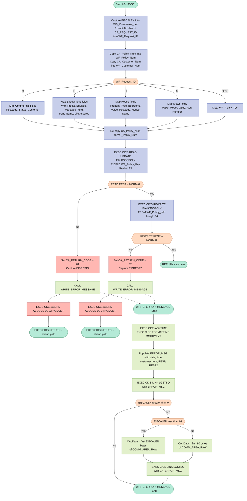
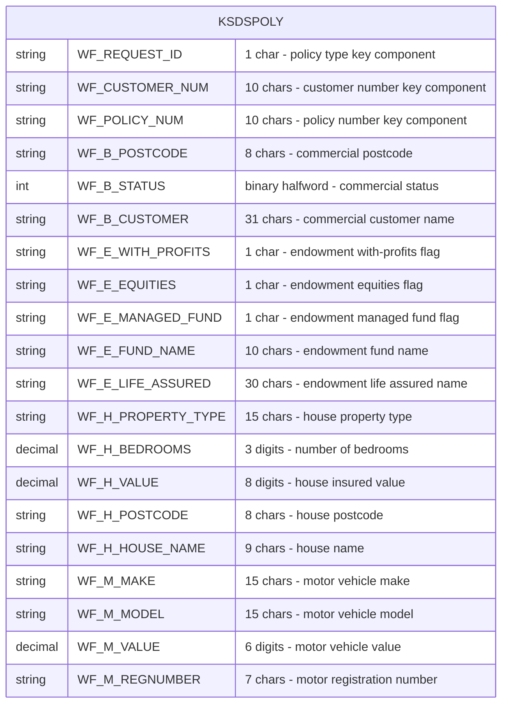

## Table of Contents

- [1. Purpose](#1-purpose)
- [2. Inputs](#2-inputs)
  - [2.1 Communication Area (COMMAREA) — passed via `COMM_AREA_PTR` parameter](#21-communication-area-commarea--passed-via-comm_area_ptr-parameter)
  - [2.2 CICS Runtime Inputs](#22-cics-runtime-inputs)
  - [2.3 VSAM File](#23-vsam-file)
- [3. Outputs](#3-outputs)
  - [3.1 VSAM File Update — KSDSPOLY](#31-vsam-file-update--ksdspoly)
  - [3.2 Communication Area — Return Code](#32-communication-area--return-code)
  - [3.3 CICS Diagnostic / Logging Output — LGSTSQ](#33-cics-diagnostic--logging-output--lgstsq)
  - [3.4 CICS Abend Signals](#34-cics-abend-signals)
- [4. Processing Logic](#4-processing-logic)
  - [4.1 Mermaid Flow Diagram](#41-mermaid-flow-diagram)
  - [4.2 Processing Logic Description](#42-processing-logic-description)
  - [4.3 Database Tables](#43-database-tables)
- [5. Paragraphs](#5-paragraphs)
- [6. Dependencies](#6-dependencies)
  - [6.1 CICS Middleware](#61-cics-middleware)
  - [6.2 VSAM File](#62-vsam-file)
  - [6.3 External Programs / Subroutines](#63-external-programs--subroutines)
  - [6.4 Input Parameters / COMMAREA](#64-input-parameters--commarea)
  - [6.5 Include / Copybook](#65-include--copybook)
  - [6.6 Compiler / Runtime Environment](#66-compiler--runtime-environment)
- [7. Constraints](#7-constraints)
  - [7.1 Input / Communication Area Constraints](#71-input--communication-area-constraints)
  - [7.2 VSAM Key Constraints](#72-vsam-key-constraints)
  - [7.3 Sequencing / Ordering Constraints](#73-sequencing--ordering-constraints)
  - [7.4 File I/O Constraints](#74-file-io-constraints)
  - [7.5 Error Handling and Return Code Constraints](#75-error-handling-and-return-code-constraints)
  - [7.6 Data Format / Size Constraints](#76-data-format--size-constraints)
- [8. Error Handling](#8-error-handling)
  - [8.1 CICS File I/O Error Detection](#81-cics-file-io-error-detection)
  - [8.2 Return Code Signalling to the Caller](#82-return-code-signalling-to-the-caller)
  - [8.3 Secondary Diagnostic Information Capture](#83-secondary-diagnostic-information-capture)
  - [8.4 Error Logging via Internal Procedure](#84-error-logging-via-internal-procedure)
  - [8.5 Controlled Program Termination](#85-controlled-program-termination)
  - [8.6 Fallback for Unrecognised Policy Type](#86-fallback-for-unrecognised-policy-type)
- [9. Examples](#9-examples)
  - [9.1 Example 1: Update a motor policy successfully](#91-example-1-update-a-motor-policy-successfully)
  - [9.2 Example 2: Update an endowment policy successfully](#92-example-2-update-an-endowment-policy-successfully)
  - [9.3 Example 3: Policy record not found during read](#93-example-3-policy-record-not-found-during-read)

## 1. Purpose

`LGUPVS01` is a CICS-hosted Enterprise PL/I program that updates existing insurance policy records stored in a VSAM KSDS file (`KSDSPOLY`). It accepts a communication area containing a customer number, policy number, and a request type identifier, then uses the request type to branch into one of four policy variants — Commercial, Endowment, House, or Motor — populating the appropriate working-storage fields from the communication area before constructing a composite VSAM key. The program issues a CICS READ UPDATE against `KSDSPOLY` to lock the target record, followed by a CICS REWRITE to persist the updated policy data; if either operation fails, a return code of `81` or `82` is placed in the communication area, a timestamped diagnostic message (including policy number, customer number, and CICS response codes) is forwarded to the `LGSTSQ` logging program, and the transaction is abended with a distinct abend code (`LGV3` or `LGV4`) before returning control to the caller.

## 2. Inputs

### 2.1 Communication Area (COMMAREA) — passed via `COMM_AREA_PTR` parameter

- **`CA_REQUEST_ID`** (`CHAR(6)`) — Full request identifier supplied by the calling transaction. The fourth character is extracted to determine which policy type variant (Commercial `'C'`, Endowment `'E'`, House `'H'`, Motor `'M'`) drives the SELECT logic and controls which policy-specific fields are populated before the VSAM rewrite.
- **`CA_RETURN_CODE`** (`PIC '99'`) — Output field written back to the caller; set to `'81'` on a failed CICS READ and `'82'` on a failed CICS REWRITE, allowing the caller to distinguish between the two error conditions.
- **`CA_CUSTOMER_NUM`** (`PIC '9999999999'`) — Ten-digit customer identifier. Copied into the VSAM key structure (`WF_Policy_Key`) to uniquely identify the record to read and rewrite, and also stamped into the error message (`EM_Cusnum`) for diagnostics.
- **`CA_POLICY_NUM`** (`PIC '9999999999'`) — Ten-digit policy number. Copied into `WF_Policy_Num` to form the second component of the composite VSAM KSDS key used on the `EXEC CICS READ UPDATE` command against `KSDSPOLY`.

#### 2.1.1 Commercial policy fields (`CA_COMMERCIAL`) — active when `CA_REQUEST_ID[4] = 'C'`
- **`CA_B_Postcode`** (`CHAR(8)`) — Postcode of the insured commercial property; written to `WF_B_Postcode` in the VSAM record.
- **`CA_B_Status`** (`PIC '9999'`) — Status code of the commercial policy; written to `WF_B_Status`.
- **`CA_B_Customer`** (`CHAR(255)`) — Customer details for the commercial policy; written to `WF_B_Customer`.

#### 2.1.2 Endowment policy fields (`CA_ENDOWMENT`) — active when `CA_REQUEST_ID[4] = 'E'`
- **`CA_E_WITH_PROFITS`** (`CHAR(1)`) — Flag indicating whether the endowment participates in a with-profits fund; written to `WF_E_WITH_PROFITS`.
- **`CA_E_EQUITIES`** (`CHAR(1)`) — Flag indicating equities participation; written to `WF_E_EQUITIES`.
- **`CA_E_MANAGED_FUND`** (`CHAR(1)`) — Flag indicating managed-fund participation; written to `WF_E_MANAGED_FUND`.
- **`CA_E_FUND_NAME`** (`CHAR(10)`) — Name of the investment fund associated with the endowment policy; written to `WF_E_FUND_NAME`.
- **`CA_E_LIFE_ASSURED`** (`CHAR(31)`) — Name of the life assured on the endowment policy; written to `WF_E_LIFE_ASSURED`.

#### 2.1.3 House policy fields (`CA_HOUSE`) — active when `CA_REQUEST_ID[4] = 'H'`
- **`CA_H_PROPERTY_TYPE`** (`CHAR(15)`) — Classification of the insured residential property (e.g., DETACHED, BUNGALOW); written to `WF_H_PROPERTY_TYPE`.
- **`CA_H_BEDROOMS`** (`PIC '999'`) — Number of bedrooms in the insured property; written to `WF_H_BEDROOMS`.
- **`CA_H_VALUE`** (`PIC '99999999'`) — Declared value of the insured property; written to `WF_H_VALUE`.
- **`CA_H_POSTCODE`** (`CHAR(8)`) — Postcode of the insured property; written to `WF_H_POSTCODE`.
- **`CA_H_HOUSE_NAME`** (`CHAR(20)`) — Name of the insured property; written to `WF_H_HOUSE_NAME`.

#### 2.1.4 Motor policy fields (`CA_MOTOR`) — active when `CA_REQUEST_ID[4] = 'M'`
- **`CA_M_MAKE`** (`CHAR(15)`) — Manufacturer name of the insured vehicle; written to `WF_M_MAKE`.
- **`CA_M_MODEL`** (`CHAR(15)`) — Model name of the insured vehicle; written to `WF_M_MODEL`.
- **`CA_M_VALUE`** (`PIC '999999'`) — Declared value of the insured vehicle; written to `WF_M_VALUE`.
- **`CA_M_REGNUMBER`** (`CHAR(7)`) — Registration number of the insured vehicle; written to `WF_M_REGNUMBER`.

### 2.2 CICS Runtime Inputs

- **`EIBCALEN`** (CICS EIB field) — Length of the inbound COMMAREA as set by CICS at entry. Used to validate that a COMMAREA was passed and to determine how many bytes of `COMM_AREA_RAW` to forward to the `LGSTSQ` error-logging program.
- **`EIBRESP2`** (CICS EIB field) — Secondary response code captured after a failed `EXEC CICS READ UPDATE` or `EXEC CICS REWRITE`; included in the error message sent to `LGSTSQ` for problem diagnosis.

### 2.3 VSAM File

- **`KSDSPOLY`** (CICS VSAM KSDS file) — The policy master dataset. The program performs a `READ UPDATE` using the composite key (`WF_Policy_Key` = request-type byte + customer number + policy number) to lock the record, then issues a `REWRITE` with the updated `WF_Policy_Info` structure. This file is both a data source (providing the current record image via `WS_FileIn`) and the update target.

## 3. Outputs

### 3.1 VSAM File Update — KSDSPOLY

- **`WF_Policy_Info`** (written via `EXEC CICS REWRITE FILE('KSDSPOLY')`)
  - The complete updated policy record written back to the KSDSPOLY VSAM KSDS dataset; serves as the primary functional output of the program
  - Contains the composite key (`WF_Policy_Key`: request ID + customer number + policy number) and the type-specific policy data payload
  - Policy data written varies by request type:
    - **Commercial (`C`)**: postcode (`WF_B_Postcode`), business status (`WF_B_Status`), customer name (`WF_B_Customer`)
    - **Endowment (`E`)**: with-profits flag (`WF_E_WITH_PROFITS`), equities flag, managed-fund flag, fund name (`WF_E_FUND_NAME`), life assured name
    - **House (`H`)**: property type (`WF_H_PROPERTY_TYPE`), bedrooms, value, postcode, house name
    - **Motor (`M`)**: make (`WF_M_MAKE`), model, value, registration number

---

### 3.2 Communication Area — Return Code

- **`CA_RETURN_CODE`** (set in the communication area passed by the caller)
  - Written back to the caller to signal the outcome of the update operation
  - Set to `'81'` when the `EXEC CICS READ UPDATE` of KSDSPOLY fails (read error)
  - Set to `'82'` when the `EXEC CICS REWRITE` of KSDSPOLY fails (write error)
  - Not explicitly set on success, leaving the caller's initial value unchanged (i.e., success is implied by absence of an error code)

---

### 3.3 CICS Diagnostic / Logging Output — LGSTSQ

- **`ERROR_MSG`** (passed via `EXEC CICS LINK PROGRAM('LGSTSQ')`)
  - A formatted error message record forwarded to the LGSTSQ logging program whenever a VSAM READ or REWRITE fails
  - Contains: date (`EM_DATE`), time (`EM_TIME`), program identifier (`LGUPVS01`), policy number (`EM_POLNUM`), customer number (`EM_CUSNUM`), CICS response code (`EM_RESPRC`), and secondary response code (`EM_RESP2RC`)
  - Serves as the primary diagnostic trace for file operation failures

- **`CA_ERROR_MSG`** (passed via a second `EXEC CICS LINK PROGRAM('LGSTSQ')`)
  - A supplementary diagnostic record containing the raw communication area content (`CA_Data`) — up to 90 bytes or `EIBCALEN` bytes, whichever is smaller — prefixed with the literal `COMMAREA=`
  - Written to LGSTSQ immediately after `ERROR_MSG` to provide the full inbound request context alongside the error details

---

### 3.4 CICS Abend Signals

- **`EXEC CICS ABEND ABCODE('LGV3') NODUMP`**
  - Issued when the CICS READ UPDATE of KSDSPOLY fails; signals a read-phase failure to CICS monitoring and any configured abend handlers

- **`EXEC CICS ABEND ABCODE('LGV4') NODUMP`**
  - Issued when the CICS REWRITE of KSDSPOLY fails; signals a write-phase failure to CICS monitoring and any configured abend handlers

## 4. Processing Logic

### 4.1 Mermaid Flow Diagram

---

### 4.2 Processing Logic Description

#### 4.2.1 High-level Summary

`LGUPVS01` is a CICS PL/I program that updates an insurance policy record stored in a VSAM KSDS dataset (`KSDSPOLY`). It receives a communication area (COMMAREA) identifying the policy type (Commercial, Endowment, House, or Motor), maps the relevant policy fields from the COMMAREA into a working storage structure, and then performs a CICS READ-for-UPDATE followed by a CICS REWRITE to persist the changes. Any file I/O failure triggers structured error logging and a controlled abend.

---

#### 4.2.2 Execution Flow

**Step 1 — Initialise from COMMAREA**
On entry, the program captures the COMMAREA length from the CICS EIB field `EIBCALEN` into `WS_Commarea_Len`. It then extracts the 4th character of `CA_REQUEST_ID` into `WF_Request_ID` — this single character is the policy-type discriminator that drives all subsequent branching. The policy number (`CA_Policy_Num`) and customer number (`CA_Customer_Num`) are copied into their working-field counterparts (`WF_Policy_Num`, `WF_Customer_Num`), which will form part of the composite 21-byte VSAM key.

**Step 2 — Policy-type field mapping (SELECT)**
A `SELECT` statement branches on `WF_Request_ID`:

| Value | Policy Type | Fields Mapped |
|-------|-------------|---------------|
| `'C'` | Commercial  | Postcode, Status, Customer name |
| `'E'` | Endowment   | With-Profits flag, Equities flag, Managed Fund flag, Fund Name, Life Assured |
| `'H'` | House       | Property Type, Bedrooms, Value, Postcode, House Name |
| `'M'` | Motor       | Make, Model, Value, Registration Number |
| Other | Unknown     | `WF_Policy_Text` is blanked |

All overlays (`WF_C_Policy_Data`, `WF_E_Policy_Data`, etc.) share the same `UNION` storage as `WF_Policy_Data`, so only the active policy variant occupies the data area that will be written back to VSAM.

**Step 3 — Re-assert policy number**
After the SELECT, `CA_Policy_Num` is copied again into `WF_Policy_Num`. This ensures the composite VSAM key (`WF_Policy_Key` = Request_ID || Customer_Num || Policy_Num, 21 bytes) reflects the latest COMMAREA value before the file operation.

**Step 4 — CICS READ UPDATE (KSDSPOLY)**
`EXEC CICS READ FILE('KSDSPOLY') … UPDATE` is issued with `RIDFLD(WF_Policy_Key)` and `KEYLENGTH(21)`. This locks the record in the VSAM KSDS for exclusive update. The response code is captured in `WS_RESP`.

- **READ succeeds** (`WS_RESP = DFHRESP(NORMAL)`): processing continues to the REWRITE.
- **READ fails**: `EIBRESP2` is saved, `CA_RETURN_CODE` is set to `'81'`, `WRITE_ERROR_MESSAGE` is called, and the program abends with ABCODE `LGV3` (NODUMP) before returning.

**Step 5 — CICS REWRITE (KSDSPOLY)**
`EXEC CICS REWRITE FILE('KSDSPOLY') FROM(WF_Policy_Info) LENGTH(64)` writes the updated `WF_Policy_Info` structure (key + policy data) back to the locked record, committing the update.

- **REWRITE succeeds**: the program falls through to a normal `RETURN`.
- **REWRITE fails**: `EIBRESP2` is saved, `CA_RETURN_CODE` is set to `'82'`, `WRITE_ERROR_MESSAGE` is called, and the program abends with ABCODE `LGV4` (NODUMP) before returning.

**Step 6 — Normal return**
If both CICS operations succeed, the program executes a PL/I `RETURN` statement, returning control to the caller with no explicit return code set (implying the caller treats the absence of `'81'`/`'82'` as success).

---

#### 4.2.3 WRITE_ERROR_MESSAGE Sub-procedure

This internal procedure is invoked on any file I/O failure:

1. **Timestamp**: `EXEC CICS ASKTIME` obtains the current absolute time; `EXEC CICS FORMATTIME MMDDYYYY` converts it to a readable date (`WS_DATE`) and time (`WS_TIME`).
2. **Build error record**: The `ERROR_MSG` structure is populated with the date, time, customer number (`CA_Customer_Num`), CICS RESP code, and RESP2 code. The structure also contains static literal markers (` LGUPVS01`, ` PNUM=`, ` CNUM=`, ` Re-write KSDSPOLY`, ` RESP=`, ` RESP2=`) for easy triage in the log.
3. **Log error message**: `EXEC CICS LINK PROGRAM('LGSTSQ')` sends the `ERROR_MSG` structure to the logging program.
4. **Log COMMAREA snapshot**: If `EIBCALEN > 0`, up to 90 bytes of the raw COMMAREA (`COMM_AREA_RAW`) are copied into `CA_Data` and logged via a second `EXEC CICS LINK PROGRAM('LGSTSQ')` call, providing a diagnostic snapshot of the inbound request.

---

#### 4.2.4 External Interactions

| System | Command | Purpose |
|--------|---------|---------|
| VSAM KSDS `KSDSPOLY` | `EXEC CICS READ UPDATE` | Exclusively lock the target policy record by composite key |
| VSAM KSDS `KSDSPOLY` | `EXEC CICS REWRITE` | Persist updated policy fields back to the locked record |
| CICS program `LGSTSQ` | `EXEC CICS LINK` | Write error/diagnostic messages to a CICS TS queue (called up to twice on failure) |

---

#### 4.2.5 Plain Language Summary

When an insurance policy needs to be updated, this program is called with details of the change. It first checks whether the policy is Commercial, Endowment, House, or Motor, and picks out only the fields relevant to that policy type. It then looks up the exact policy record in the VSAM database using a unique key made up of the request type, customer number, and policy number, locks it so no other transaction can change it simultaneously, and overwrites it with the new values. If anything goes wrong during the lookup or the save, the program records a detailed error message (including a timestamp and a snapshot of the incoming data) to a central log, then signals a controlled failure back to the caller using a specific return code — `81` for a read failure and `82` for a write failure.

---

### 4.3 Database Tables

## 5. Paragraphs

The program `LGUPVS01` has two logical sections of executable code: the **main procedure body** (inline, no procedure label) and one internal subroutine — `WRITE_ERROR_MESSAGE`. Below is the paragraph-by-paragraph breakdown.

---

- **LGUPVS01 (Main Procedure Body)**
  - This is the primary execution path of the program, entered when CICS links to `LGUPVS01` with a COMMAREA pointer. It orchestrates the full VSAM KSDS policy-record update from COMMAREA extraction through to the CICS REWRITE.
  - **Initialisation and key extraction:**
    - Captures the COMMAREA length from the CICS EIB field `EIBCALEN` into `WS_Commarea_Len`.
    - Extracts the fourth character of `CA_REQUEST_ID` (via `SUBSTR`) into `WF_Request_ID` to determine the policy type being updated.
    - Copies `CA_Policy_Num` and `CA_Customer_Num` into the working-field counterparts `WF_Policy_Num` and `WF_Customer_Num`, which together with `WF_Request_ID` form the 21-byte composite VSAM key (`WF_Policy_Key`).
  - **Policy-type data mapping (SELECT/WHEN block):**
    - A `SELECT (WF_Request_ID)` statement branches on the single-character policy type code:
      - `WHEN ('C')` — Commercial policy: maps `CA_B_Postcode`, `CA_B_Status`, and `CA_B_Customer` from the COMMAREA into the `WF_C_Policy_Data` overlay fields.
      - `WHEN ('E')` — Endowment policy: maps `CA_E_WITH_PROFITS`, `CA_E_EQUITIES`, `CA_E_MANAGED_FUND`, `CA_E_FUND_NAME`, and `CA_E_LIFE_ASSURED` into the `WF_E_Policy_Data` overlay.
      - `WHEN ('H')` — House policy: maps `CA_H_PROPERTY_TYPE`, `CA_H_BEDROOMS`, `CA_H_VALUE`, `CA_H_POSTCODE`, and `CA_H_HOUSE_NAME` into the `WF_H_Policy_Data` overlay.
      - `WHEN ('M')` — Motor policy: maps `CA_M_MAKE`, `CA_M_MODEL`, `CA_M_VALUE`, and `CA_M_REGNUMBER` into the `WF_M_Policy_Data` overlay.
      - `OTHERWISE` — Any unrecognised type: clears `WF_Policy_Text` to spaces.
    - The `WF_Policy_Data` field is defined as a `UNION`, so only one overlay is active at a time, aligned to the same storage.
  - **VSAM READ for update:**
    - Issues `EXEC CICS READ FILE('KSDSPOLY')` with `UPDATE`, using `WF_Policy_Key` as the `RIDFLD` and a `KEYLENGTH` of 21 bytes. The record is read into `WS_FileIn` (1024-byte buffer). This locks the record for the subsequent REWRITE.
    - If `WS_RESP` is not `DFHRESP(NORMAL)`, captures `EIBRESP2` into `WS_RESP2`, sets `CA_RETURN_CODE` to `'81'`, calls `WRITE_ERROR_MESSAGE`, issues `EXEC CICS ABEND ABCODE('LGV3') NODUMP` (abends the task without a dump), and then `EXEC CICS RETURN` to terminate.
  - **VSAM REWRITE:**
    - Issues `EXEC CICS REWRITE FILE('KSDSPOLY')` using `WF_Policy_Info` as the `FROM` source and `WS_Commarea_LenF` (64 bytes) as the record length, writing the updated policy key and type-specific data back to the KSDS.
    - If `WS_RESP` is not `DFHRESP(NORMAL)`, captures `EIBRESP2`, sets `CA_RETURN_CODE` to `'82'`, calls `WRITE_ERROR_MESSAGE`, issues `EXEC CICS ABEND ABCODE('LGV4') NODUMP`, and returns.
  - **Normal return:**
    - On success, executes a bare `RETURN` statement, returning control to the CICS caller with no error code set in the COMMAREA (the caller interprets the absence of `'81'`/`'82'` as success).

---

- **WRITE_ERROR_MESSAGE (Internal Subroutine)**
  - An internal `PROCEDURE` (called via `CALL WRITE_ERROR_MESSAGE`) invoked exclusively on VSAM failure. Its sole purpose is to build and dispatch structured error messages to the CICS temporary-storage logging program `LGSTSQ`.
  - **Timestamp acquisition:**
    - Calls `EXEC CICS ASKTIME ABSTIME(WS_ABSTIME)` to obtain the current absolute time as a binary integer.
    - Calls `EXEC CICS FORMATTIME ABSTIME(WS_ABSTIME) MMDDYYYY(WS_DATE) TIME(WS_TIME)` to produce a human-readable date (`MM/DD/YYYY`) and time (`HH:MM:SS`) for inclusion in the error record.
  - **Error message population:**
    - Moves `WS_DATE` and `WS_TIME` into `EM_DATE` and `EM_TIME` fields of the `ERROR_MSG` structure.
    - Sets `EM_Cusnum` from `CA_Customer_Num` so the failing customer can be identified in logs.
    - Sets `EM_RespRC` from `WS_RESP` and `EM_Resp2RC` from `WS_RESP2` to record the CICS response codes. The `ERROR_MSG` structure also carries pre-initialised literals such as `'LGUPVS01'`, `' PNUM='`, `' CNUM='`, and `' Re-write KSDSPOLY  '`.
  - **First error-message dispatch:**
    - Issues `EXEC CICS LINK PROGRAM('LGSTSQ') COMMAREA(ERROR_MSG) LENGTH(STG(ERROR_MSG))` to send the formatted error record to the logging program.
  - **COMMAREA diagnostic dump (conditional):**
    - Checks `EIBCALEN > 0`; if a COMMAREA is present, determines how much of it to log:
      - If `EIBCALEN < 91`: extracts exactly `EIBCALEN` bytes from the raw COMMAREA (`COMM_AREA_RAW`) via `LEFT()` into `CA_Data`.
      - Otherwise: extracts the first 90 bytes into `CA_Data`.
    - In either branch, issues a second `EXEC CICS LINK PROGRAM('LGSTSQ') COMMAREA(CA_ERROR_MSG)` call to log the raw COMMAREA content alongside the `'COMMAREA='` prefix literal.
  - **Return:** Terminates with `RETURN` and `END WRITE_ERROR_MESSAGE`, giving control back to the main procedure body which then proceeds to abend and return.

## 6. Dependencies

### 6.1 CICS Middleware

- **CICS Transaction Server (CICS TS)**
  - The program runs as a CICS-managed transaction; all I/O, timing, and inter-program communication are handled through CICS API commands
  - `EXEC CICS READ FILE … UPDATE` — issues a read-for-update lock against the VSAM KSDS file
  - `EXEC CICS REWRITE FILE` — writes the updated policy record back to the VSAM file
  - `EXEC CICS ASKTIME` / `EXEC CICS FORMATTIME` — retrieves and formats the current system timestamp for error logging
  - `EXEC CICS LINK PROGRAM(...)` — synchronously invokes the logging sub-program
  - `EXEC CICS ABEND ABCODE(…) NODUMP` — signals an abnormal end with a specific abend code when a file operation fails
  - `EXEC CICS RETURN` — returns control to the calling transaction
  - **EIB (Execute Interface Block)** — `EIBCALEN` is read to determine the inbound COMMAREA length; `EIBRESP2` is read to capture secondary response codes on file errors
  - `DFHRESP(NORMAL)` — CICS-supplied constant used to test the `RESP` field after each CICS command

### 6.2 VSAM File

- **KSDSPOLY** (VSAM KSDS dataset)
  - The primary persistent store for all policy types (Commercial, Endowment, House, Motor)
  - Accessed by name via `EXEC CICS READ FILE('KSDSPOLY')` and `EXEC CICS REWRITE FILE('KSDSPOLY')`
  - Records are located using a 21-byte composite key (`WF_Policy_Key`: Request ID + Customer Number + Policy Number)
  - Must be defined in the CICS File Control Table (FCT) with update-enabled access

### 6.3 External Programs / Subroutines

- **LGSTSQ** (CICS-linked logging program)
  - Invoked via `EXEC CICS LINK PROGRAM('LGSTSQ')` up to three times within the `WRITE_ERROR_MESSAGE` internal procedure
  - First call passes `ERROR_MSG` (date, time, program name, policy/customer numbers, RESP codes) to record the error
  - Second and third calls (conditional on `EIBCALEN`) pass `CA_ERROR_MSG`, which contains the first 90 bytes (or `EIBCALEN` bytes) of the raw inbound COMMAREA for diagnostic context

### 6.4 Input Parameters / COMMAREA

- **COMM_AREA** (passed via `COMM_AREA_PTR`)
  - The sole mechanism by which the calling program supplies all input data to `LGUPVS01`
  - Defined by the included copybook `LGCMAREA` (source: `plinc/LGCMAREA.inc`), expanded inline at compile time via `%INCLUDE LGCMAREA`
  - Key fields consumed at runtime:
    - `CA_REQUEST_ID` — 6-character request identifier; fourth character selects the policy type variant (`C`, `E`, `H`, or `M`)
    - `CA_RETURN_CODE` — written back to signal success or failure (`81` = read failure, `82` = rewrite failure)
    - `CA_CUSTOMER_NUM` — customer identifier forming part of the VSAM key
    - `CA_POLICY_NUM` — policy number forming part of the VSAM key
    - `CA_B_*` fields — Commercial policy data (`CA_B_Postcode`, `CA_B_Status`, `CA_B_Customer`)
    - `CA_E_*` fields — Endowment policy data (`CA_E_WITH_PROFITS`, `CA_E_EQUITIES`, `CA_E_MANAGED_FUND`, `CA_E_FUND_NAME`, `CA_E_LIFE_ASSURED`)
    - `CA_H_*` fields — House policy data (`CA_H_PROPERTY_TYPE`, `CA_H_BEDROOMS`, `CA_H_VALUE`, `CA_H_POSTCODE`, `CA_H_HOUSE_NAME`)
    - `CA_M_*` fields — Motor policy data (`CA_M_MAKE`, `CA_M_MODEL`, `CA_M_VALUE`, `CA_M_REGNUMBER`)

### 6.5 Include / Copybook

- **LGCMAREA** (`plinc/LGCMAREA.inc`)
  - PL/I include file that defines the full `COMM_AREA` structure (UNION-based, 32,500 bytes) shared across all CICS programs in the GenApp suite
  - Expanded inline into the program source at compile time via the `%INCLUDE` preprocessor directive

### 6.6 Compiler / Runtime Environment

- **Enterprise PL/I for z/OS V52** compiler
  - Compile parameters: `SYSTEM(CICS),PP(MACRO,CICS)` — enables CICS macro preprocessing required to translate `EXEC CICS` statements
  - Link-edit parameters: `MAP,RENT,COMPAT(PM5)` — produces a reentrant load module deployed to the `CICSLOAD` library
  - Acceptable return code: RC ≤ 4 (warnings allowed); link edit must be RC=0

## 7. Constraints

### 7.1 Input / Communication Area Constraints

- **COMMAREA must be present at invocation**
  - `WS_Commarea_Len` is immediately loaded from `EIBCALEN` (line 215); if `EIBCALEN` is zero the program has no guard at the main level, but the diagnostic path in `WRITE_ERROR_MESSAGE` explicitly tests `IF (EIBCALEN > 0)` before attempting to log COMMAREA content, meaning the program assumes a non-zero-length COMMAREA is always supplied by the caller
  - The COMMAREA is declared as a `UNION` with a maximum raw extent of 32,500 characters (`COMM_AREA_RAW CHAR(32500)`); the actual content passed by the caller must not exceed this boundary

- **`CA_REQUEST_ID` must encode a supported policy type in position 4**
  - The fourth character is extracted via `SUBSTR(CA_Request_ID,4,1)` into `WF_Request_ID` (line 216)
  - Only the values `'C'` (Commercial), `'E'` (Endowment), `'H'` (House), and `'M'` (Motor) are recognised by the `SELECT` statement (lines 222–253)
  - Any other value falls into the `OTHERWISE` branch, which blanks `WF_Policy_Text` and writes no policy-type-specific fields; the VSAM update still proceeds but with zeroed/blank policy data — there is no explicit rejection or error return for an unrecognised type

- **`CA_CUSTOMER_NUM` must be a 10-digit numeric picture value** (`PIC '9999999999'`); non-numeric content would violate the picture-clause type constraint at data-movement time

- **`CA_POLICY_NUM` must be a 10-digit numeric picture value** (`PIC '9999999999'`); the value is copied into `WF_Policy_Num` (CHAR(10)) and forms part of the composite VSAM key

---

### 7.2 VSAM Key Constraints

- **The composite VSAM key (`WF_Policy_Key`) is exactly 21 bytes and is fixed**
  - The key is assembled from three sub-fields: `WF_Request_ID` (1 byte) + `WF_Customer_Num` (10 bytes) + `WF_Policy_Num` (10 bytes) = 21 bytes total
  - The `EXEC CICS READ` command hard-codes `KeyLength(21)` (line 262); the key length presented to CICS must equal exactly 21, matching the KSDS VSAM definition; a mismatch would cause a CICS IOERR condition

- **The key must uniquely identify an existing record in `KSDSPOLY`**
  - The READ is issued with the `UPDATE` option; if no matching record exists the CICS NOTFND (or other non-NORMAL) response is returned, triggering the read-failure path

---

### 7.3 Sequencing / Ordering Constraints

- **The READ UPDATE must succeed before a REWRITE can be issued**
  - CICS requires that a REWRITE be preceded by a successful READ UPDATE against the same file within the same CICS task; the program enforces this by checking `WS_RESP` after the READ (line 266) and terminating with `EXEC CICS ABEND ABCODE('LGV3') NODUMP` + `EXEC CICS RETURN` if the READ fails, so the REWRITE is never reached
  - This is both a CICS API sequencing rule and an explicit program-level gate

- **Policy-type data must be populated before the REWRITE**
  - The `SELECT (WF_Request_ID)` block (lines 220–254) runs before the CICS READ and REWRITE; all working-storage policy fields are set in this step — the REWRITE always uses `WF_Policy_Info` as the source, so populating the correct overlay prior to issuing the REWRITE is mandatory

- **`WF_Policy_Num` is re-assigned after the SELECT block** (line 256, a second `WF_Policy_Num = CA_Policy_Num`), ensuring the key field contains the correct value even if any SELECT branch accidentally altered it

---

### 7.4 File I/O Constraints

- **READ uses a dynamic length (`WS_Commarea_Len` = `EIBCALEN`)** (line 260)
  - The number of bytes read from `KSDSPOLY` is governed by the actual COMMAREA length passed by the caller at runtime; the caller therefore controls how much of the VSAM record is brought into `WS_FileIn`

- **REWRITE uses a fixed length of 64 bytes (`WS_Commarea_LenF` initialised to `64`)** (lines 31, 276)
  - Only the first 64 bytes of `WF_Policy_Info` are written back regardless of how much data was read or how large the policy-type overlay is; policy-type data structures that exceed 64 bytes (e.g., `WF_C_Policy_Data` at 41 bytes, `WF_E_Policy_Data` at 43 bytes, `WF_H_Policy_Data` at 35 bytes, `WF_M_Policy_Data` at 37 bytes) are constrained to fit within this 64-byte boundary for the rewrite to be complete
  - The VSAM file record length at the `KSDSPOLY` dataset level must accommodate at least 64 bytes

- **The target file is hard-coded as `'KSDSPOLY'`** (lines 258, 274); no alternative file name is permitted at runtime

---

### 7.5 Error Handling and Return Code Constraints

- **A CICS READ failure sets `CA_RETURN_CODE` to `'81'` and terminates with abend code `LGV3`**
  - Processing halts immediately; the REWRITE is never attempted
  - The abend is issued with `NODUMP`, suppressing a system dump

- **A CICS REWRITE failure sets `CA_RETURN_CODE` to `'82'` and terminates with abend code `LGV4`**
  - Similarly issued with `NODUMP`

- **`CA_RETURN_CODE` is a two-digit numeric picture field (`PIC '99'`)** in the COMMAREA; only the values `'81'` and `'82'` are set by this program — success leaves the return code at whatever value the caller placed in it (no explicit success code is written)

- **Error logging is conditional on COMMAREA presence**
  - Inside `WRITE_ERROR_MESSAGE`, COMMAREA content is forwarded to the `LGSTSQ` logging program only when `EIBCALEN > 0`
  - When `EIBCALEN < 91`, the logged COMMAREA data is truncated to `EIBCALEN` bytes; otherwise it is capped at 90 bytes (the `CA_Data` field size), enforcing a hard 90-byte maximum for the logged COMMAREA snapshot

---

### 7.6 Data Format / Size Constraints

- **`WF_H_BEDROOMS`** is declared `PIC '(3)9'` (3-digit numeric), limiting bedroom count to 0–999
- **`WF_H_VALUE`** is declared `PIC '(8)9'` (8-digit numeric), limiting property value to 0–99,999,999
- **`WF_M_VALUE`** is declared `PIC '(6)9'` (6-digit numeric), limiting vehicle value to 0–999,999
- **`WF_B_Status`** is declared `FIXED BIN(15)`, constraining the commercial policy status to a 15-bit signed binary integer (−32,768 to +32,767)
- **`WF_M_REGNUMBER`** is 7 characters, matching the standard UK vehicle registration format length
- **`WF_H_HOUSE_NAME`** is stored in 9 characters in the working structure, while the COMMAREA source `CA_H_HOUSE_NAME` is 20 characters; only the first 9 characters of the house name are retained in the VSAM record
- **`WF_B_Customer`** is 31 characters in the working structure, while `CA_B_Customer` is 255 characters in the COMMAREA; commercial customer name data is truncated to 31 characters when written to VSAM

## 8. Error Handling

### 8.1 CICS File I/O Error Detection

- After each CICS file command, the `RESP` option captures the response code into `WS_RESP`, and the program explicitly tests whether this value differs from `DFHRESP(NORMAL)` — the CICS-defined constant for a successful response
  - Following the `EXEC CICS READ UPDATE` against the `KSDSPOLY` file, if `WS_RESP` is not `DFHRESP(NORMAL)`, the read failure path is triggered
  - Following the `EXEC CICS REWRITE` against the same file, if `WS_RESP` is not `DFHRESP(NORMAL)`, the write failure path is triggered

### 8.2 Return Code Signalling to the Caller

- When the CICS READ fails, `CA_RETURN_CODE` in the communication area is set to `'81'`, distinguishing a read-phase failure
- When the CICS REWRITE fails, `CA_RETURN_CODE` is set to `'82'`, distinguishing a write-phase failure
- These distinct codes allow the calling program to determine precisely which VSAM operation failed without needing to inspect internal state

### 8.3 Secondary Diagnostic Information Capture

- On any file error, `WS_RESP2` is immediately populated from `EIBRESP2`, the CICS-provided secondary response code that supplies additional detail beyond the primary `RESP` value (e.g., specific file-not-found or record-locked subcodes)
- Both the primary response code (`WS_RESP`) and the secondary response code (`WS_RESP2`) are preserved and later embedded into the error message

### 8.4 Error Logging via Internal Procedure

- Both error paths invoke the internal `WRITE_ERROR_MESSAGE` procedure before any terminal action is taken
- Within `WRITE_ERROR_MESSAGE`:
  - `EXEC CICS ASKTIME` retrieves the current absolute time into `WS_ABSTIME`
  - `EXEC CICS FORMATTIME` converts `WS_ABSTIME` into a human-readable date (`WS_DATE`, MM/DD/YYYY) and time (`WS_TIME`) that are stamped into the `ERROR_MSG` structure
  - The error message structure (`ERROR_MSG`) is assembled with the timestamp, the program identifier (`LGUPVS01`), the customer number (`EM_CUSNUM`), the operation description (`Re-write KSDSPOLY`), and both response codes (`EM_RESPRC`, `EM_RESP2RC`)
  - `EXEC CICS LINK PROGRAM('LGSTSQ')` is called with the `ERROR_MSG` commarea to forward the structured error record to a dedicated TS queue logging program
  - A second logging call is made with `CA_ERROR_MSG`, which captures the raw content of the inbound communication area for additional context:
    - If `EIBCALEN` is greater than zero and less than 91, exactly `EIBCALEN` bytes of the raw commarea (`COMM_AREA_RAW`) are extracted using the `LEFT` built-in function and logged
    - If `EIBCALEN` is 91 or greater, the first 90 bytes are extracted and logged, preventing buffer overflow in the `CA_Data` field
  - The commarea dump is only attempted when `EIBCALEN > 0`, guarding against a null or empty commarea

### 8.5 Controlled Program Termination

- After logging, each error path issues `EXEC CICS ABEND ABCODE(...)  NODUMP` to force a controlled transaction abend:
  - Abend code `'LGV3'` identifies a READ failure
  - Abend code `'LGV4'` identifies a REWRITE failure
  - The `NODUMP` option suppresses a full system dump, limiting the diagnostic footprint to the log entries already written
- Immediately following the abend command, `EXEC CICS RETURN` is issued to ensure the task terminates cleanly, preventing any further processing from occurring after the error is detected

### 8.6 Fallback for Unrecognised Policy Type

- The `SELECT (WF_Request_ID)` construct handles policy-type routing; the `OTHERWISE` branch provides a safe default when the request identifier does not match any known policy type (`'C'`, `'E'`, `'H'`, `'M'`)
- In this fallback, `WF_Policy_Text` is blanked out, preventing uninitialised data from being written to the VSAM record and providing a neutral safe state for unexpected request types

## 9. Examples

### 9.1 Example 1: Update a motor policy successfully

**Sample input data**
- `CA_REQUEST_ID = '01UMOT'`  
  - 4th character = `M`
- `CA_CUSTOMER_NUM = '0000001234'`
- `CA_POLICY_NUM = '0000456789'`
- Motor fields:
  - `CA_M_MAKE = 'TOYOTA'`
  - `CA_M_MODEL = 'COROLLA'`
  - `CA_M_VALUE = 018500`
  - `CA_M_REGNUMBER = 'AB12CDE'`

**Expected output**
- The VSAM record in `KSDSPOLY` for key:
  - request type `M`
  - customer `0000001234`
  - policy `0000456789`
  is rewritten with:
  - make = `TOYOTA`
  - model = `COROLLA`
  - value = `018500`
  - registration = `AB12CDE`
- `CA_RETURN_CODE` remains unchanged from its normal value.

**Explanation**
- The program takes the 4th character of `CA_REQUEST_ID`, so `M` selects motor-policy logic.
- It builds the VSAM key from request id, customer number, and policy number.
- It copies the motor-specific fields into `WF_Policy_Info`, does a `READ ... UPDATE` on `KSDSPOLY`, then `REWRITE`s the updated 64-byte record.
- Because both CICS file operations succeed, no error code is set.

### 9.2 Example 2: Update an endowment policy successfully

**Sample input data**
- `CA_REQUEST_ID = '01UEOW'`  
  - 4th character = `E`
- `CA_CUSTOMER_NUM = '0000002222'`
- `CA_POLICY_NUM = '0000007777'`
- Endowment fields:
  - `CA_E_WITH_PROFITS = 'Y'`
  - `CA_E_EQUITIES = 'N'`
  - `CA_E_MANAGED_FUND = 'Y'`
  - `CA_E_FUND_NAME = 'GROWTH01'`
  - `CA_E_LIFE_ASSURED = 'JANE SMITH'`

**Expected output**
- The VSAM record in `KSDSPOLY` for key:
  - request type `E`
  - customer `0000002222`
  - policy `0000007777`
  is rewritten with:
  - with-profits = `Y`
  - equities = `N`
  - managed fund = `Y`
  - fund name = `GROWTH01`
  - life assured = `JANE SMITH`
- `CA_RETURN_CODE` remains unchanged from its normal value.

**Explanation**
- The 4th character `E` causes the program to populate the endowment overlay in `WF_Policy_Data`.
- After the keyed `READ UPDATE`, it rewrites the same policy record with the new endowment values.
- No error handling is triggered when the file operations are normal.

### 9.3 Example 3: Policy record not found during read

**Sample input data**
- `CA_REQUEST_ID = '01UHSE'`  
  - 4th character = `H`
- `CA_CUSTOMER_NUM = '9999999999'`
- `CA_POLICY_NUM = '9999999999'`
- House fields:
  - `CA_H_PROPERTY_TYPE = 'DETACHED'`
  - `CA_H_BEDROOMS = 004`
  - `CA_H_VALUE = 00550000`
  - `CA_H_POSTCODE = 'AB12CD34'`
  - `CA_H_HOUSE_NAME = 'ROSEBANK'`

**Expected output**
- `CA_RETURN_CODE = '81'`
- An error message is logged through program `LGSTSQ`
- The transaction abends with code `LGV3`

**Explanation**
- The program identifies this as a house-policy update because the 4th character is `H`.
- It attempts a keyed `READ ... UPDATE` on `KSDSPOLY`.
- If that read fails, the program sets return code `81`, records diagnostic information, and issues `EXEC CICS ABEND ABCODE('LGV3')`.

---

Generated by IBM Bob Premium Package for Z
