## Table of Contents

- [1. Purpose](#1-purpose)
- [2. Inputs](#2-inputs)
  - [2.1 CICS EIB Fields (Runtime Context — Provided by CICS at Task Start)](#21-cics-eib-fields-runtime-context--provided-by-cics-at-task-start)
  - [2.2 CICS Named Counters (External Counter Repository — Read via `EXEC CICS QUERY COUNTER`)](#22-cics-named-counters-external-counter-repository--read-via-exec-cics-query-counter)
  - [2.3 CICS Temporary Storage Queues (Previous-Interval State — Read via `EXEC CICS READQ TS`)](#23-cics-temporary-storage-queues-previous-interval-state--read-via-exec-cics-readq-ts)
  - [2.4 CICS System Time (Provided by CICS Runtime — `EXEC CICS ASKTIME` / `FORMATTIME`)](#24-cics-system-time-provided-by-cics-runtime--exec-cics-asktime--formattime)
- [3. Outputs](#3-outputs)
- [4. Processing Logic](#4-processing-logic)
  - [4.1 Mermaid Flow Diagram](#41-mermaid-flow-diagram)
  - [4.2 Processing Logic Description](#42-processing-logic-description)
  - [4.3 Database Tables](#43-database-tables)
- [5. Paragraphs](#5-paragraphs)
- [6. Dependencies](#6-dependencies)
  - [6.1 CICS Named Counters](#61-cics-named-counters)
  - [6.2 CICS Temporary Storage Queues (TSQs)](#62-cics-temporary-storage-queues-tsqs)
  - [6.3 CICS Transaction](#63-cics-transaction)
  - [6.4 CICS Runtime Environment](#64-cics-runtime-environment)
  - [6.5 CICS Load Module / Program Definition](#65-cics-load-module--program-definition)
  - [6.6 Internal Subroutines](#66-internal-subroutines)
- [7. Constraints](#7-constraints)
  - [7.1 Data Format Constraints](#71-data-format-constraints)
  - [7.2 Counter Table and Loop Constraints](#72-counter-table-and-loop-constraints)
  - [7.3 TSQ Structure and Item-Order Constraints](#73-tsq-structure-and-item-order-constraints)
  - [7.4 Sequencing and Execution-Order Constraints](#74-sequencing-and-execution-order-constraints)
  - [7.5 Scheduling and Timing Constraints](#75-scheduling-and-timing-constraints)
  - [7.6 Resource and Pool Constraints](#76-resource-and-pool-constraints)
- [8. Error Handling](#8-error-handling)
  - [8.1 CICS RESP-Based Conditional Error Handling](#81-cics-resp-based-conditional-error-handling)
  - [8.2 CICS RESP Capture Without Explicit Checks (Silent Error Tolerance)](#82-cics-resp-capture-without-explicit-checks-silent-error-tolerance)
  - [8.3 Recovery and Fallback Logic](#83-recovery-and-fallback-logic)
- [9. Examples](#9-examples)
  - [9.1 Example 1: First Run (No Prior State in TS Queues)](#91-example-1-first-run-no-prior-state-in-ts-queues)
  - [9.2 Example 2: Subsequent Run (Prior State Exists)](#92-example-2-subsequent-run-prior-state-exists)
  - [9.3 Example 3: Interval Time Calculation Across Midnight](#93-example-3-interval-time-calculation-across-midnight)

## 1. Purpose

`LGWEBST5` is a CICS-hosted PL/I statistics collector for the GenApp insurance application that periodically harvests CICS named counters representing successful and failed transactions across all GenApp business operations — customer inquiries and additions, and motor, endowment, house, and commercial policy inquiries, additions, updates, and deletions — and persists both absolute and delta (rate-of-change) values into CICS Temporary Storage Queues for downstream reporting and dashboard consumption. On each execution it reads the previous counter snapshots from the TSQs, computes the difference since the last run, writes the updated triple of new/old/delta values back, accumulates totals broken down by operation type (inquire, add, update, delete), reschedules itself to fire again after one minute via `EXEC CICS START TRANSID('SSST')`, and then returns, thereby creating a self-sustaining, minute-interval statistics pipeline.

## 2. Inputs

### 2.1 CICS EIB Fields (Runtime Context — Provided by CICS at Task Start)

- **`EIBTRNID`** — The 4-character CICS transaction ID under which the current task is executing. Read from the CICS Execute Interface Block (EIB) and stored into `WS_TRANSID` for identification/logging purposes.
- **`EIBTRMID`** — The 4-character terminal ID associated with the current CICS task. Read from the EIB and stored into `WS_TERMID`.
- **`EIBTASKN`** — The 7-digit task number assigned by CICS to the current transaction instance. Read from the EIB and stored into `WS_TASKNUM`.
- **`EIBCALEN`** — The length of the COMMAREA passed to this program. Read from the EIB and stored into `WS_CALEN`. A value of zero indicates no COMMAREA was passed.

### 2.2 CICS Named Counters (External Counter Repository — Read via `EXEC CICS QUERY COUNTER`)

- **`GENACOUNT` / pool `GENA`** — The named counter `GENACUSTNUM` in the `GENA` counter pool. Holds the total number of customers created (a running sequence counter). Queried once to capture the current customer number counter value.
- **`CT_SUCCESS(1..17)`** — An array of 17 named CICS counters (e.g., `GENA01ICUS00`, `GENA01AMOT00`) in the `GENA` pool, one per GenApp business operation (inquire/add/update/delete) across all policy types (customer, motor, endowment, house, commercial). Each counter records the cumulative count of successful transactions for that operation.
- **`CT_ERROR(1..17)`** — A parallel array of 17 named CICS error counters (e.g., `GENA01ICUS99`, `GENA01AMOT99`) in the `GENA` pool. Each holds the cumulative count of failed/error transactions for the corresponding operation.

### 2.3 CICS Temporary Storage Queues (Previous-Interval State — Read via `EXEC CICS READQ TS`)

- **`GENA000V` TS Queue** — Stores the 6-character HHMMSS timestamp from the previous execution of this program. Read at startup to compute the elapsed interval since the last run. If absent (first run), a default value of `120000` is used.
- **`GENA<code>V` TS Queues (rate queues, one per counter)** — A set of TS queues named by concatenating `GENA` with a 3-character code (e.g., `GENA100V`, `GENANX05V`) and suffix `V`, one for each of the 18 success counters (17 operation counters + 1 customer counter). Item 1 of each queue holds the counter's value from the previous collection interval. This previous value (`ORATEVAL`) is read and used to compute the per-interval delta.

### 2.4 CICS System Time (Provided by CICS Runtime — `EXEC CICS ASKTIME` / `FORMATTIME`)

- **Current absolute time (`WS_ABSTIME`)** — The current CICS system time in absolute clock format, obtained via `EXEC CICS ASKTIME`. Formatted into a date (`WS_DATE`, MM/DD/YYYY) and time (`WS_TIME`, HHMMSSXX) via `EXEC CICS FORMATTIME`. The HHMMSS portion is used to compute the elapsed interval since the last run and to record the current timestamp for the next run.

## 3. Outputs

**CICS Temporary Storage Queues (TS Queues) — Written Data**

- **Rate-interval queue `GENA000V`** — written by `TRAN_RATE_INTERVAL`
  - Item 1 (`WS_HHMMSS`, 6 bytes): current HHMMSS timestamp, replacing the previous run's timestamp
  - Item 2 (`WS_NEWV`, 6 bytes): elapsed seconds between the previous and current run, used by downstream consumers to normalise per-second rates

- **Customer-number counter rate queue `GENAX05V`** — written by `TRAN_RATE_COUNTS` after querying `GENACUSTNUM`
  - Item 1 (`NRATEVAL`, 9 bytes): current raw counter value (new snapshot)
  - Item 2 (`ORATEVAL`, 9 bytes): previous raw counter value (old snapshot)
  - Item 3 (`DRATEVAL`, 9 bytes): absolute delta between new and old snapshots

- **Per-operation success-counter rate queues `GENA100V` – `GENAHV00`** (17 queues, one per entry in `CT_CODE`) — written by `TRAN_RATE_COUNTS` for each success counter in `CT_SUCCESS`
  - Item 1: current value of the corresponding `GENA01Ixxxxx00` / `GENA01Axxxxx00` / `GENA01Dxxxxx00` / `GENA01Uxxxxx00` success counter
  - Item 2: previous (old) value from the prior run
  - Item 3: delta (change over the collection interval) for that individual operation/entity combination

- **Total success rate queue `GENAX00V`** — written after the counter loop with the rolled-up `COUNTSUCCESS` value
  - Item 1: total successful transactions (all operation types, all policy entities)
  - Item 2: previous total success value
  - Item 3: delta total success count

- **Total inquire rate queue `GENAX01V`** — written with `COUNTINQ`
  - Item 1: total successful inquiry operations
  - Item 2: previous inquiry value
  - Item 3: delta inquiry count

- **Total add rate queue `GENAX02V`** — written with `COUNTADD`
  - Item 1: total successful add operations
  - Item 2: previous add value
  - Item 3: delta add count

- **Total update rate queue `GENAX03V`** — written with `COUNTUPD`
  - Item 1: total successful update operations
  - Item 2: previous update value
  - Item 3: delta update count

- **Total delete rate queue `GENAX04V`** — written with `COUNTDEL`
  - Item 1: total successful delete operations
  - Item 2: previous delete value
  - Item 3: delta delete count

**CICS Named Counters — Read (Input Side Effects)**

- **`GENACUSTNUM` counter** (pool `GENA`): queried once via `EXEC CICS QUERY COUNTER`; its `VALUE` is the current customer-number sequence value, feeding the `GENAX05V` rate queue

- **`CT_SUCCESS(1..17)` counters** (e.g., `GENA01ICUS00`, `GENA01ACUS00`, …, `GENA01DCOM00`): queried once each per run; values accumulate into `COUNTSUCCESS` and the per-operation counts, and each feeds its own rate queue

- **`CT_ERROR(1..17)` counters** (e.g., `GENA01ICUS99`, …, `GENA01DCOM99`): queried once each per run; values accumulate into `COUNTERRORS` (consumed internally as a running total for the interval — note: `COUNTERRORS` is not itself written to any TS queue in this program, so it has no direct external output in the current implementation)

**CICS Transaction Scheduling — `EXEC CICS START`**

- **Transaction `SSST` scheduled to start after 1 minute**: the primary self-restart side effect; causes CICS to re-invoke `LGWEBST5` automatically every minute to repeat the statistics collection cycle. This is the mechanism that keeps the collector running continuously.

## 4. Processing Logic

### 4.1 Mermaid Flow Diagram

```mermaid
graph TD
    classDef startEnd fill:#d4edda,stroke:#6aaf7a,color:#000
    classDef process fill:#cce5ff,stroke:#5b9bd5,color:#000
    classDef decision fill:#fff3cd,stroke:#e6a817,color:#000
    classDef subprocess fill:#e2d9f3,stroke:#8e6bbf,color:#000
    classDef io fill:#fde8e8,stroke:#d9534f,color:#000

    A([Start LGWEBST5]):::startEnd
    B[Initialize WS_HEADER<br>Capture EIBTRNID EIBTRMID<br>EIBTASKN EIBCALEN]:::process
    C[EXEC CICS ASKTIME<br>EXEC CICS FORMATTIME<br>Get current date and time]:::process
    D[CALL TRAN_RATE_INTERVAL]:::subprocess
    E[Zero out all accumulators<br>COUNTSUCCESS COUNTERRORS<br>COUNTINQ COUNTADD COUNTUPD COUNTDEL]:::process

    subgraph RATE_INTERVAL [TRAN_RATE_INTERVAL Subroutine]
        RI1[Read TS Queue GENA000V item 1<br>Get previous run time WS_OLDV]:::io
        RI2{{Read successful}}:::decision
        RI3[Set WS_OLDV to 120000<br>default midnight]:::process
        RI4[Delete TS Queue GENA000V]:::io
        RI5[Write current HHMMSS to<br>TS Queue GENA000V item 1]:::io
        RI6[Convert current and old<br>times to seconds<br>Compute delta ICOUNTVAL]:::process
        RI7[Write delta seconds to<br>TS Queue GENA000V item 2]:::io
        RI8[EXEC CICS START TRANSID SSST<br>AFTER MINUTES 1<br>Schedule next run]:::process
    end

    F[Query CICS Named Counter GENACUSTNUM<br>Get customer number count into COUNTVAL]:::io
    G[Set TSQ Name to GENAX05V<br>Set NRATEVAL to COUNTVAL<br>CALL TRAN_RATE_COUNTS]:::subprocess

    subgraph RATE_COUNTS [TRAN_RATE_COUNTS Subroutine]
        RC1[Read TS Queue WS_TSQNAME item 1<br>9-char previous value]:::io
        RC2{{Read successful}}:::decision
        RC3[Set ORATEVAL from WS_TSQDATA]:::process
        RC4[Set ORATEVAL to 0<br>first run default]:::process
        RC5[Delete TS Queue WS_TSQNAME]:::io
        RC6[Write NRATEVAL as item 1<br>new snapshot]:::io
        RC7[Write ORATEVAL as item 2<br>previous snapshot]:::io
        RC8[Compute DRATEVAL = ABS NRATEVAL - ORATEVAL<br>Write as item 3<br>delta rate]:::io
    end

    H[BEGIN Loop I = 1 TO 17]:::process
    I[Query success counter CT_SUCCESS I<br>Add COUNTVAL to COUNTSUCCESS]:::io
    J{{Operation type CT_OPS I}}:::decision
    J1[COUNTINQ plus COUNTVAL]:::process
    J2[COUNTADD plus COUNTVAL]:::process
    J3[COUNTUPD plus COUNTVAL]:::process
    J4[COUNTDEL plus COUNTVAL]:::process
    K[Build TSQ Name GENA plus CT_CODE I plus V<br>Set NRATEVAL<br>CALL TRAN_RATE_COUNTS]:::subprocess
    L[Query error counter CT_ERROR I<br>Add COUNTVAL to COUNTERRORS]:::io
    M{{I less than or equal to 17}}:::decision

    N[Write totals to TSQ GENAX00V<br>COUNTSUCCESS rate]:::subprocess
    O[Write totals to TSQ GENAX01V<br>COUNTINQ rate]:::subprocess
    P[Write totals to TSQ GENAX02V<br>COUNTADD rate]:::subprocess
    Q[Write totals to TSQ GENAX03V<br>COUNTUPD rate]:::subprocess
    R[Write totals to TSQ GENAX04V<br>COUNTDEL rate]:::subprocess
    S[EXEC CICS RETURN]:::startEnd

    A --> B --> C --> D
    D --> RI1
    RI1 --> RI2
    RI2 -- Yes --> RI4
    RI2 -- No --> RI3 --> RI4
    RI4 --> RI5 --> RI6 --> RI7 --> RI8
    RI8 --> E

    E --> F --> G
    G --> RC1
    RC1 --> RC2
    RC2 -- Yes --> RC3 --> RC5
    RC2 -- No --> RC4 --> RC5
    RC5 --> RC6 --> RC7 --> RC8

    RC8 --> H
    H --> I --> J
    J -- I --> J1 --> K
    J -- A --> J2 --> K
    J -- U --> J3 --> K
    J -- D --> J4 --> K
    K --> L --> M
    M -- Yes --> I
    M -- No --> N

    N --> O --> P --> Q --> R --> S([End EXEC CICS RETURN]):::startEnd
```

---

### 4.2 Processing Logic Description

#### 4.2.1 High-level Summary

`LGWEBST5` is a CICS statistics-collection daemon for the GenApp insurance application. It runs as a self-scheduling transaction (`SSST`): each invocation queries all CICS named counters that track GenApp business operations, computes per-interval delta rates (new minus old), persists those rates in CICS Temporary Storage Queues (TSQs), and then schedules itself to run again in exactly one minute.

---

#### 4.2.2 Execution Flow

**Step 1 — Initialization**
The program begins by capturing EIB fields (transaction ID, terminal ID, task number, COMMAREA length) into the `WS_HEADER` diagnostic block. `EXEC CICS ASKTIME` and `EXEC CICS FORMATTIME` retrieve the current absolute time, formatted into `WS_DATE` (MM/DD/YYYY) and `WS_TIME` (HH:MM:SS).

**Step 2 — Interval calculation (`TRAN_RATE_INTERVAL`)**
This subroutine is called immediately after time retrieval:

1. **Read previous run timestamp** — Attempts `EXEC CICS READQ TS` on queue `GENA000V` item 1 (a 6-byte `HHMMSS` string). If the queue does not exist (first ever run), `WS_OLDV` is defaulted to `'120000'` (midnight) to avoid a divide-by-zero scenario downstream.
2. **Refresh the timestamp** — The queue is deleted (`EXEC CICS DELETEQ TS`) and the current `HHMMSS` is written back as item 1.
3. **Compute elapsed seconds** — Both the current time and the old time are converted to total seconds since midnight (hours×3600 + minutes×60 + seconds). The absolute difference (`ICOUNTVAL`) is the collection interval duration.
4. **Persist interval** — The delta seconds value is written to `GENA000V` item 2.
5. **Schedule next run** — `EXEC CICS START TRANSID('SSST') AFTER MINUTES(1)` arranges for the same transaction to fire again after 60 seconds.

**Step 3 — Zero accumulators**
All six counters (`COUNTSUCCESS`, `COUNTERRORS`, `COUNTINQ`, `COUNTADD`, `COUNTUPD`, `COUNTDEL`) are set to zero.

**Step 4 — Customer-number counter snapshot**
`EXEC CICS QUERY COUNTER(GENACUSTNUM)` retrieves the current customer-number sequence value. This is treated as a standalone metric: its new/old/delta values are stored in TSQ `GENAX05V` via `TRAN_RATE_COUNTS`.

**Step 5 — Transaction counter loop (17 iterations)**
The program iterates `I = 1 TO 17` over the static parallel arrays `CT_SUCCESS`, `CT_ERROR`, `CT_CODE`, and `CT_OPS`:

- **Success counter** — `EXEC CICS QUERY COUNTER(CT_SUCCESS(I))` returns `COUNTVAL`. It is added to `COUNTSUCCESS`. The operation character `CT_OPS(I)` routes `COUNTVAL` into the correct per-operation accumulator:
  - `'I'` → `COUNTINQ` (Inquire)
  - `'A'` → `COUNTADD` (Add)
  - `'U'` → `COUNTUPD` (Update)
  - `'D'` → `COUNTDEL` (Delete)
- **Rate tracking** — TSQ name `GENA` + `CT_CODE(I)` + `'V'` is built (e.g., `GENA100V` for counter 1). `NRATEVAL` is set to `COUNTVAL` and `TRAN_RATE_COUNTS` is called to persist the new/old/delta triple.
- **Error counter** — `EXEC CICS QUERY COUNTER(CT_ERROR(I))` returns the error tally, which is added to `COUNTERRORS`.

**Step 6 — `TRAN_RATE_COUNTS` subroutine (called per counter)**
This subroutine manages a 3-item TSQ per counter:

1. **Read item 1** (`EXEC CICS READQ TS … ITEM(1)`) — retrieves the previously stored new-value (9 chars). If successful, it becomes `ORATEVAL`; on any error (QIDERR on first run), `ORATEVAL` defaults to `0`.
2. **Delete the queue** (`EXEC CICS DELETEQ TS`) — clears all prior items.
3. **Write item 1** — `NRATEVAL` (current snapshot) written as new item 1.
4. **Write item 2** — `ORATEVAL` (previous snapshot) written as item 2.
5. **Write item 3** — `DRATEVAL = ABS(NRATEVAL − ORATEVAL)` (delta/rate) written as item 3.

**Step 7 — Aggregate totals**
After the loop, five aggregate accumulators are written to dedicated TSQs using `TRAN_RATE_COUNTS`:

| TSQ Name   | Value           |
|------------|-----------------|
| `GENAX00V` | Total successes |
| `GENAX01V` | Inquire count   |
| `GENAX02V` | Add count       |
| `GENAX03V` | Update count    |
| `GENAX04V` | Delete count    |

**Step 8 — Return**
`EXEC CICS RETURN` ends the task. The next execution is already scheduled (from Step 2 Step 5 of `TRAN_RATE_INTERVAL`).

---

#### 4.2.3 External Interactions

| Mechanism | Resource | Purpose |
|---|---|---|
| `EXEC CICS QUERY COUNTER … POOL(GENA)` | Named counters `CT_SUCCESS(1..17)`, `CT_ERROR(1..17)`, `GENACUSTNUM` | Read current cumulative values of all 35 GenApp operation counters |
| `EXEC CICS READQ TS` | `GENA000V`, `GENA100V`–`GENAHXXV`, `GENAX00V`–`GENAX05V` | Read previously stored counter snapshots to compute deltas |
| `EXEC CICS DELETEQ TS` | Same queues | Clear old items before rewriting the 3-item (new/old/delta) structure |
| `EXEC CICS WRITEQ TS` | Same queues | Persist updated new value, old value, and delta for each counter |
| `EXEC CICS START TRANSID('SSST') AFTER MINUTES(1)` | Transaction `SSST` | Self-schedule: ensure the statistics collector fires again in one minute |
| `EXEC CICS ASKTIME` / `FORMATTIME` | CICS clock | Obtain current wall-clock time for interval calculation |

---

#### 4.2.4 Plain Language Summary

LGWEBST5 is an automatic background statistics reporter that wakes up every minute. Each time it runs, it reads 35 activity counters maintained by the GenApp application — counters that record how many customer inquiries, policy additions, updates, and deletions have succeeded or failed. For each counter it compares the current reading against the last reading it saved, producing a "rate" value (the delta). All three figures — current total, previous total, and delta — are saved into short-lived CICS memory queues so that dashboards or monitoring screens can display near-real-time throughput numbers. It also produces rolled-up totals (overall success, errors, and each operation type). Finally, before finishing, it schedules an identical copy of itself to run one minute later, keeping the statistics cycle perpetually alive.

---

### 4.3 Database Tables

No DB2 SQL statements are present in `LGWEBST5`. All persistent state is maintained exclusively via CICS Temporary Storage Queues (TSQs); there are no relational database interactions.

## 5. Paragraphs

- **LGWEBST5**
  - Main procedure that collects GenApp statistics, updates rate-tracking temporary storage queues, and reschedules itself for the next execution.
  - Initializes header/context fields from CICS execution interface values, gets the current date/time with `EXEC CICS ASKTIME` and `FORMATTIME`, and calls `TRAN_RATE_INTERVAL` to calculate elapsed time and restart the collector transaction.
  - Resets accumulator variables for total successes, total errors, and per-operation success counts.
  - Queries the customer number named counter (`GENACUSTNUM`), places its current value into the `GENAX05V` queue via `TRAN_RATE_COUNTS`.
  - Iterates through 17 business transaction success counters using `CT_SUCCESS`, adds each current value into `COUNTSUCCESS`, classifies it into inquire/add/update/delete totals using `CT_OPS`, builds a queue name from `CT_CODE`, and calls `TRAN_RATE_COUNTS` for each success counter.
  - In the same loop, queries the matching error counter from `CT_ERROR` and adds it to `COUNTERRORS`.
  - After the loop, writes aggregate success and per-operation totals to summary queues `GENAX00V` through `GENAX04V` by repeatedly setting `WS_TSQNAME`, loading `NRATEVAL`, and calling `TRAN_RATE_COUNTS`.
  - Ends with `EXEC CICS RETURN`.
  - Control flow includes a `DO I = 1 TO 17` loop and a `SELECT` statement routing counts by operation code.
  - External interactions are entirely through CICS: named counter queries, time services, temporary storage queue processing, and program return.

- **TRAN_RATE_INTERVAL**
  - Computes the elapsed seconds since the previous run and schedules the next run one minute later.
  - Uses queue `GENA000V` to store timing information between executions.
  - Reads item 1 of the queue into `WS_OLDV`; if the read is not successful, defaults the prior time to `'120000'`.
  - Deletes the queue, extracts `HHMMSS` from the current formatted time, and writes the current time back to the queue.
  - Converts current and prior `HHMMSS` values into seconds (`NCOUNTVAL` and `OCOUNTVAL`), calculates the absolute difference, moves it to `ICOUNTVAL`/`WS_NEWV`, then writes that elapsed value to `GENA000V`.
  - Starts transaction `SSST` with `EXEC CICS START ... AFTER MINUTES(1)` so the collector runs again in one minute.
  - Control flow includes a conditional response check on the `READQ TS`.
  - External interactions are CICS temporary storage queue read/delete/write operations and a CICS delayed transaction start.

- **TRAN_RATE_COUNTS**
  - Maintains, for a given counter queue, the current value, previous value, and delta between them.
  - Reads item 1 of the queue named in `WS_TSQNAME`; if present, treats it as the old value (`ORATEVAL`), otherwise defaults the old value to zero.
  - Deletes the existing queue contents before rebuilding the queue.
  - Writes three items back to the same queue in order: the new value (`NRATEVAL`), the old value (`ORATEVAL`), and the absolute difference (`DRATEVAL = ABS(NRATEVAL - ORATEVAL)`).
  - Provides a reusable service routine for both individual counters and roll-up totals.
  - Control flow consists of an `IF/ELSE` on the `READQ TS` response code.
  - External interactions are CICS temporary storage queue read, delete, and write operations.

## 6. Dependencies

### 6.1 CICS Named Counters

- **Counter pool `GENA`** — The named counter pool that groups all GenApp counters. Specified via `POOL(GENAPOOL)` on every `EXEC CICS QUERY COUNTER` call. Must be defined in the CICS region's named counter server configuration.
  - **`GENACUSTNUM`** — Named counter tracking the total number of GenApp customers created. Queried once; its value is stored in the rate-tracking TSQ `GENAX05V`.
  - **Success counters (`CT_SUCCESS`, 17 entries)** — Named counters of the form `GENA01<OP><ENTITY>00` (e.g., `GENA01ICUS00`, `GENA01AMOT00`, …`GENA01DCOM00`). One counter per operation/entity combination (Inquire/Add/Delete/Update × Customer/Motor/Endowment/House/Commercial). Queried in a loop to accumulate per-operation totals.
  - **Error counters (`CT_ERROR`, 17 entries)** — Named counters of the form `GENA01<OP><ENTITY>99` (e.g., `GENA01ICUS99`, …`GENA01DCOM99`). Parallel to the success counters; queried in the same loop to accumulate overall error totals.

---

### 6.2 CICS Temporary Storage Queues (TSQs)

All queues use the prefix `GENA` and are managed via `EXEC CICS READQ TS`, `WRITEQ TS`, and `DELETEQ TS`. They persist state between invocations (previous/current/delta values for rate calculations).

- **`GENA000V`** — Interval-tracking queue. Stores the HHMMSS timestamp of the previous run (item 1) and the elapsed-seconds delta (item 2). Read and rewritten by the `TRAN_RATE_INTERVAL` internal procedure.
- **`GENAX05V`** — Rate-tracking queue for the `GENACUSTNUM` customer-count counter. Holds new value (item 1), old value (item 2), and delta (item 3).
- **`GENA<code>V` (17 queues, codes `100`–`H00`)** — One rate-tracking TSQ per success counter (e.g., `GENA100V`, `GENA200V`, …`GENAH00V`). Each stores the new, old, and delta values for the corresponding named counter across collection intervals.
- **`GENAX00V`** — Rate-tracking queue for the total success count (`COUNTSUCCESS`).
- **`GENAX01V`** — Rate-tracking queue for the total inquiry count (`COUNTINQ`).
- **`GENAX02V`** — Rate-tracking queue for the total add count (`COUNTADD`).
- **`GENAX03V`** — Rate-tracking queue for the total update count (`COUNTUPD`).
- **`GENAX04V`** — Rate-tracking queue for the total delete count (`COUNTDEL`).

---

### 6.3 CICS Transaction

- **Transaction `SSST`** — The program schedules itself to restart after one minute via `EXEC CICS START TRANSID('SSST') AFTER MINUTES(1)`. This transaction ID must be defined in the CICS CSD (CEDA) and must reference the `LGWEBST5` program load module.

---

### 6.4 CICS Runtime Environment

- **EXEC Interface Block (EIB)** — Provided automatically by CICS at task startup. The program reads:
  - `EIBTRNID` — current transaction identifier, stored in `WS_TRANSID`
  - `EIBTRMID` — terminal identifier, stored in `WS_TERMID`
  - `EIBTASKN` — task number, stored in `WS_TASKNUM`
  - `EIBCALEN` — COMMAREA length, stored in `WS_CALEN`
- **`EXEC CICS ASKTIME` / `EXEC CICS FORMATTIME`** — CICS system clock services used to obtain the current date and time (formatted as `MMDDYYYY` and `HHMMSS`). Used to compute the elapsed interval since the last run.
- **`EXEC CICS RETURN`** — Returns control to CICS at program end.
- **`DFHRESP(NORMAL)`** — CICS-supplied response code constant used to check whether TS queue reads succeeded (e.g., to detect a first-run condition when no prior TSQ exists).

---

### 6.5 CICS Load Module / Program Definition

- **`LGWEBST5` program entry** — Must be defined as a CICS program resource (CEDA DEFINE PROGRAM) and deployed to the `CICSLOAD` load library. The program is invoked as the entry point for transaction `SSST`.

---

### 6.6 Internal Subroutines

- **`TRAN_RATE_INTERVAL`** — Internal PL/I procedure (no external call). Reads/writes the `GENA000V` TSQ to determine elapsed seconds since last run, computes the interval delta, and schedules the next execution via `EXEC CICS START TRANSID('SSST')`.
- **`TRAN_RATE_COUNTS`** — Internal PL/I procedure (no external call). For each named counter, reads the previous value from the named TSQ (`WS_TSQNAME`), deletes it, and rewrites three items: new value, old value, and delta.

## 7. Constraints

### 7.1 Data Format Constraints

- **Rate value fields (`NRATEVAL`, `ORATEVAL`, `DRATEVAL`) are declared as `PIC '999999999'`**, restricting each to exactly 9 decimal digits (0–999,999,999). Any counter value exceeding 999,999,999 will overflow or truncate silently on assignment.
- **Interval timestamp fields (`WS_HHMMSS`, `WS_OLDV`, `WS_NEWV`) are exactly 6 characters**, representing `HHMMSS`. The time extraction at line 177 strictly reads the first 6 characters of `WS_TIME` (an 8-character field), meaning seconds-sub-field and any trailing data are discarded.
- **`WS_TSQNAME` is exactly 8 characters**, constructed by concatenating the 4-character prefix `'GENA'` with a 3- or 4-character suffix. TSQ names that do not conform to this 8-character length are not possible given the static prefix and fixed-length code values.
- **`WS_TSQDATA` is exactly 9 characters**, and is the sole data buffer for all TSQ read/write operations in `TRAN_RATE_COUNTS`. Both `NRATEVAL` and `ORATEVAL` are 9-digit picture fields, so the buffer length is tightly coupled to the picture field width.
- **`ICOUNTVAL` is declared `PIC '999999'`** (6 digits), limiting the computed elapsed-seconds value to a maximum of 999,999 seconds. Since the value is derived from `ABS(NCOUNTVAL - OCOUNTVAL)` where both operands are seconds-since-midnight (max 86,399), this constraint is not violated in practice but is implicitly enforced by the picture declaration.
- **`WS_TSQLEN` is `FIXED BIN(15)`**, meaning TSQ lengths passed to `READQ`/`WRITEQ` are limited to values representable in a 15-bit signed binary integer. Both lengths used (6 and 9) are well within range.

### 7.2 Counter Table and Loop Constraints

- **Exactly 17 counters are processed per run.** The arrays `CT_SUCCESS`, `CT_ERROR`, and `CT_CODE` are all statically sized to 17 elements (lines 60–78), and the processing loop iterates `DO I = 1 TO 17` (line 113). No mechanism exists to extend or reduce this count at runtime.
- **`CT_OPS` must be exactly 17 characters** and must contain only the characters `'I'`, `'A'`, `'U'`, or `'D'` at each position (line 80). The `SELECT` statement at line 119 covers only these four cases with no `OTHERWISE` clause; any other character in `CT_OPS` at position `I` will raise a `SELECT` condition error (unhandled `NOVALUE` condition in PL/I).
- **`CT_SUCCESS(I)`, `CT_ERROR(I)`, and `CT_CODE(I)` must be positionally aligned.** The code relies on array index `I` to simultaneously identify the success counter name, error counter name, rate TSQ code suffix, and operation type. Misalignment among any of these four static structures would silently produce incorrect statistics.
- **Counter names in `CT_SUCCESS` and `CT_ERROR` follow the fixed pattern `GENA01<OP><ENT><STATUS>`**, where `<STATUS>` is `00` for success and `99` for error. The pool is always `'GENA'` (line 57). Any named counter that does not exist in the CICS named counter pool when `EXEC CICS QUERY COUNTER` is issued will result in a non-NORMAL `RESP`; this is captured in `WS_RESP` but is not acted upon — the last value of `COUNTVAL` from a prior successful query (or its `INIT(0)`) would be used, silently corrupting accumulator totals.

### 7.3 TSQ Structure and Item-Order Constraints

- **Rate TSQs (`GENA<code>V`) must follow a strict 3-item structure**: item 1 = current value (9 chars), item 2 = previous value (9 chars), item 3 = delta value (9 chars). The `TRAN_RATE_COUNTS` procedure deletes and rewrites the queue in this exact order on every invocation. Downstream consumers of these TSQs must read items 1, 2, and 3 in sequence and must not depend on item existence across restarts.
- **The interval TSQ `GENA000V` must hold a single 6-character item** representing the previous run's `HHMMSS` timestamp. The procedure `TRAN_RATE_INTERVAL` deletes and rewrites this queue on every invocation (lines 174–200). If the queue is absent (first run or manual deletion), the old time is defaulted to `'120000'` (12:00:00), meaning the computed interval on first run will reflect seconds elapsed since noon, not since the last actual execution.
- **The `READQ TS ITEM(1)` call reads only the first item.** If additional items exist in a rate TSQ from a previous run cycle, they are discarded when the queue is deleted. Only the first item (the previous "new" value) is preserved as the old rate baseline.

### 7.4 Sequencing and Execution-Order Constraints

- **`TRAN_RATE_INTERVAL` must be called before any counter queries.** It is invoked at line 94, prior to the accumulator resets and counter loops. This ensures the interval TSQ `GENA000V` is updated and the `SSST` restart is scheduled before any statistics are written. Calling it after would write stale timing data.
- **All accumulator variables (`COUNTSUCCESS`, `COUNTERRORS`, `COUNTINQ`, `COUNTADD`, `COUNTUPD`, `COUNTDEL`) must be reset to zero before the counter loop.** This is enforced at lines 96–101. Because PL/I does not auto-initialize `FIXED BIN` variables without an `INIT` clause, failure to execute these assignments would carry garbage or prior-run values into the loop accumulation.
- **The customer-number counter (`GENACUSTNUM`) is queried and its rate TSQ (`GENAX05V`) is written before the transaction counter loop begins** (lines 104–110). Its value is not added to any of the six accumulators — it is treated exclusively as a rate-tracked counter, not a success/error counter.
- **The five aggregate rate TSQs (`GENAX00V`–`GENAX04V`) are written only after the counter loop completes** (lines 137–155). They depend on fully accumulated values of `COUNTSUCCESS`, `COUNTINQ`, `COUNTADD`, `COUNTUPD`, and `COUNTDEL`. Writing them mid-loop would produce partial totals.
- **`EXEC CICS RETURN` is issued immediately after the last TSQ write** (line 157), with no conditional paths. The program always terminates normally regardless of any `WS_RESP` values encountered during processing.

### 7.5 Scheduling and Timing Constraints

- **The program schedules its own restart exactly once per invocation** via `EXEC CICS START TRANSID('SSST') AFTER MINUTES(1)` (lines 202–204). If the program itself fails before reaching this call (e.g., abend before `TRAN_RATE_INTERVAL` returns), no restart is scheduled and the statistics collection chain stops.
- **The restart interval is fixed at 1 minute** and is not configurable at runtime. There is no parameter, TSQ flag, or COMMAREA mechanism to alter the interval.
- **The computed elapsed interval is expressed in whole seconds only.** The conversion at lines 183–186 and 188–191 uses integer arithmetic (`HHVAL * 3600 + MMVAL * 60 + SSVAL`); sub-second granularity is not tracked.
- **Midnight crossing is handled by the `ABS()` function** (line 193). If the new time is less than the old time (i.e., a midnight boundary was crossed), `ABS()` prevents a negative result, but the computed interval will be incorrect — it will represent the absolute difference rather than the true elapsed time across midnight.

### 7.6 Resource and Pool Constraints

- **All CICS named counters must reside in the single pool `'GENA'** (declared at line 57 and used in all `EXEC CICS QUERY COUNTER` calls). Counters in other pools are not accessible.
- **All TSQ names are exactly 8 characters**, constructed from the 4-character prefix `'GENA'` plus a 3- or 4-character suffix. The naming scheme is fully static; no dynamic TSQ name construction based on terminal ID, task number, or user ID is performed, meaning these queues are global and shared across all instances of the transaction running concurrently.
- **No CICS error conditions are handled beyond capturing `RESP`** into `WS_RESP`. All `EXEC CICS` commands use `RESP(WS_RESP)`, which suppresses automatic CICS condition handling, but the value of `WS_RESP` is only inspected in two places (lines 171 and 219). All other CICS failures (e.g., `WRITEQ` storage exhaustion, `START` failure) are silently ignored.

## 8. Error Handling

### 8.1 CICS RESP-Based Conditional Error Handling

- **`TRAN_RATE_INTERVAL` — TSQ read failure fallback**
  - After issuing `EXEC CICS READQ TS` to retrieve the previous timestamp from queue `GENA000V`, the response code is captured in `WS_RESP`
  - If `WS_RESP` is anything other than `DFHRESP(NORMAL)` (i.e., the queue does not exist, the item is not found, or any other abnormal condition), the program applies a recovery/fallback strategy: `WS_OLDV` is hardcoded to `'120000'` (representing 12:00:00)
  - This handles the **first-run scenario** where no prior timestamp has been stored, preventing an uninitialized or garbage value from corrupting the elapsed-time calculation

- **`TRAN_RATE_COUNTS` — TSQ read success/failure branch**
  - After issuing `EXEC CICS READQ TS` to retrieve the prior rate snapshot from the named counter queue (`GENA<code>V`), the response code is checked against `DFHRESP(NORMAL)`
  - If the read succeeds (`WS_RESP = DFHRESP(NORMAL)`), the old rate value (`ORATEVAL`) is populated from the queue data
  - If the read fails (queue not yet written — first run for this counter), `ORATEVAL` is explicitly defaulted to `0`, providing a safe baseline for the delta calculation
  - This is a deliberate improvement over the original COBOL version, which reused whatever residual value was left in working storage

### 8.2 CICS RESP Capture Without Explicit Checks (Silent Error Tolerance)

- **`DELETEQ TS` calls (both procedures)**
  - Both `TRAN_RATE_INTERVAL` and `TRAN_RATE_COUNTS` issue `EXEC CICS DELETEQ TS` with `RESP(WS_RESP)`, but the response is not subsequently inspected
  - This is intentional tolerance: if the queue does not exist at delete time (e.g., first run), no corrective action is needed and the program silently continues

- **`WRITEQ TS` calls (both procedures)**
  - Multiple `EXEC CICS WRITEQ TS` calls across both procedures capture `RESP(WS_RESP)` but do not evaluate it afterwards
  - Errors during writes (e.g., storage shortage) are absorbed without notification or retry; the program continues processing remaining counters

- **`EXEC CICS QUERY COUNTER` calls (main body)**
  - All 34 counter query operations (one for customer count, 17 for success counters, 17 for error counters) specify `RESP(WS_RESP)` but do not branch on the result
  - If a named counter does not exist or is otherwise inaccessible, the failure is silently ignored; `COUNTVAL` retains its prior value and the accumulation proceeds unchecked

- **`EXEC CICS START TRANSID('SSST')` (inside `TRAN_RATE_INTERVAL`)**
  - The self-rescheduling `START` command captures `RESP(WS_RESP)` but does not evaluate it
  - If the transaction cannot be scheduled (e.g., resource constraint), no alert or retry is performed; the statistics cycle would simply stop rescheduling without any visible indication

### 8.3 Recovery and Fallback Logic

- **Default-to-zero for missing old rate values**
  - When `TRAN_RATE_COUNTS` cannot read a prior value for a counter from its TSQ, `ORATEVAL` is set to `0` rather than leaving it undefined, ensuring the computed delta (`DRATEVAL = ABS(NRATEVAL - ORATEVAL)`) equals the full cumulative counter value on the first execution — a safe and predictable initialization

- **Default timestamp for missing interval anchor**
  - When `TRAN_RATE_INTERVAL` cannot read the prior run time from `GENA000V`, `WS_OLDV` is set to `'120000'`, providing a fixed reference point to avoid arithmetic errors in the elapsed-seconds calculation on the first invocation

- **`ABS()` on delta computations**
  - Both `ABS(NCOUNTVAL - OCOUNTVAL)` in `TRAN_RATE_INTERVAL` and `ABS(NRATEVAL - ORATEVAL)` in `TRAN_RATE_COUNTS` use absolute value, guarding against negative results if a counter wraps around or if clock midnight-crossing causes the new time to be numerically less than the old time

## 9. Examples

### 9.1 Example 1: First Run (No Prior State in TS Queues)

**Scenario:** LGWEBST5 runs for the very first time. No Temporary Storage Queues exist yet, so there are no previous counter values.

**Input State (CICS Named Counter values at startup):**

| Counter Name   | Operation | Value |
|----------------|-----------|-------|
| GENA01ICUS00   | Inquire Customer | 50 |
| GENA01ACUS00   | Add Customer     | 10 |
| GENA01IMOT00   | Inquire Motor    | 30 |
| GENA01AMOT00   | Add Motor        | 5  |
| GENA01ICUS99   | Error Inquire Customer | 2 |
| GENA01ACUS99   | Error Add Customer     | 1 |
| *(all remaining 11 success + error counters)* | — | 0 |
| GENACUSTNUM    | Customer Number Counter | 500 |

**Program Execution & Output:**

1. **Interval Calculation (`TRAN_RATE_INTERVAL`):**  
   - TS queue `GENA000V` does not exist → `WS_OLDV` defaults to `'120000'` (12:00:00).  
   - Current time is, say, `14:05:30` → `NCOUNTVAL = 50730`, `OCOUNTVAL = 43200`.  
   - `ICOUNTVAL = ABS(50730 - 43200) = 7530` seconds elapsed; written as item 2 in `GENA000V`.  
   - CICS START schedules transaction `SSST` to fire again in 1 minute.

2. **Counter loop (I = 1 to 17):**
   - All 17 success TSQ queues (`GENA100V` … `GENAM00V`) are not found → `ORATEVAL = 0` for every counter.
   - For I=1 (`GENA01ICUS00`, value=50, op=`I`): `NRATEVAL=50`, `ORATEVAL=0`, `DRATEVAL=50`.  
     TSQ `GENA100V` is written with items: new=`000000050`, old=`000000000`, delta=`000000050`.  
     `COUNTSUCCESS += 50`, `COUNTINQ += 50`.
   - For I=2 (`GENA01ACUS00`, value=10, op=`A`): TSQ `GENA200V` written similarly.  
     `COUNTSUCCESS += 10`, `COUNTADD += 10`.
   - For I=3 (`GENA01IMOT00`, value=30, op=`I`): `COUNTSUCCESS += 30`, `COUNTINQ += 30`.
   - For I=4 (`GENA01AMOT00`, value=5, op=`A`): `COUNTSUCCESS += 5`, `COUNTADD += 5`.
   - All error counters: `GENA01ICUS99=2`, `GENA01ACUS99=1` → `COUNTERRORS = 3`; rest are 0.

3. **Totals written:**

| TSQ Name   | Content (new / old / delta) |
|------------|-----------------------------|
| `GENAX00V` | 000000095 / 000000000 / 000000095 ← total successes |
| `GENAX01V` | 000000080 / 000000000 / 000000080 ← total inquires (50+30) |
| `GENAX02V` | 000000015 / 000000000 / 000000015 ← total adds (10+5) |
| `GENAX03V` | 000000000 / 000000000 / 000000000 ← total updates |
| `GENAX04V` | 000000000 / 000000000 / 000000000 ← total deletes |

Because there is no prior state, old values are all zero and deltas equal the new values.

---

### 9.2 Example 2: Subsequent Run (Prior State Exists)

**Scenario:** LGWEBST5 fires again ~60 seconds later (scheduled via `SSST`). TS queues from the previous run are present. Some transactions have occurred in the interval.

**Input State:**

- TS queue `GENA100V` item 1 = `000000050` (previous value for Inquire Customer).
- CICS named counter `GENA01ICUS00` now has value **75** (25 new successful inquiries since last run).
- `GENA01ICUS99` (error counter) = **4** (2 new errors).
- All other counters unchanged from Example 1.

**Program Execution & Output for the `GENA01ICUS00` counter (I=1):**

1. `EXEC CICS QUERY COUNTER('GENA01ICUS00')` → `COUNTVAL = 75`.
2. `COUNTSUCCESS += 75`, `COUNTINQ += 75`.
3. `WS_TSQNAME = 'GENA100V'`, `NRATEVAL = 75`.
4. In `TRAN_RATE_COUNTS`:
   - `READQ TS GENA100V ITEM(1)` → `WS_TSQDATA = '000000050'` → `ORATEVAL = 50`.
   - `DRATEVAL = ABS(75 - 50) = 25`.
   - TSQ `GENA100V` is deleted, then rewritten with three items:
     - Item 1 (new): `000000075`
     - Item 2 (old): `000000050`
     - Item 3 (delta): `000000025`

5. Error counter `GENA01ICUS99 = 4` → `COUNTERRORS += 4`.

**Key Takeaway:** The delta value (`000000025`) represents exactly the 25 new successful customer inquiries that occurred during the ~60-second interval. Downstream dashboards or monitors read item 3 from each TSQ to display per-interval transaction rates rather than cumulative totals.

---

### 9.3 Example 3: Interval Time Calculation Across Midnight

**Scenario:** The previous run timestamp stored in `GENA000V` is `235500` (23:55:00), and the current time is `000100` (00:01:00) — the program ran across midnight.

**Input:**
- `WS_OLDV = '235500'` (read from `GENA000V`)
- `WS_HHMMSS = '000100'` (current time)

**Calculation:**
- `NCOUNTVAL = (0×3600) + (1×60) + 0 = 60` seconds.
- `OCOUNTVAL = (23×3600) + (55×60) + 0 = 85500 + 3300 = 86100` seconds... wait — but `ABS(60 − 86100) = 86040`.

**Output:** `ICOUNTVAL = 86040` seconds (correctly handled by `ABS()`, avoiding a negative elapsed time). The interval is recorded as `086040` in `GENA000V` item 2, and transaction `SSST` is rescheduled for 1 minute later. This shows that the `ABS()` function protects the interval calculation against midnight crossover, though the resulting value (≈23.9 hours) would be anomalous — a known edge case in this design.

---

Generated by IBM Bob Premium Package for Z
